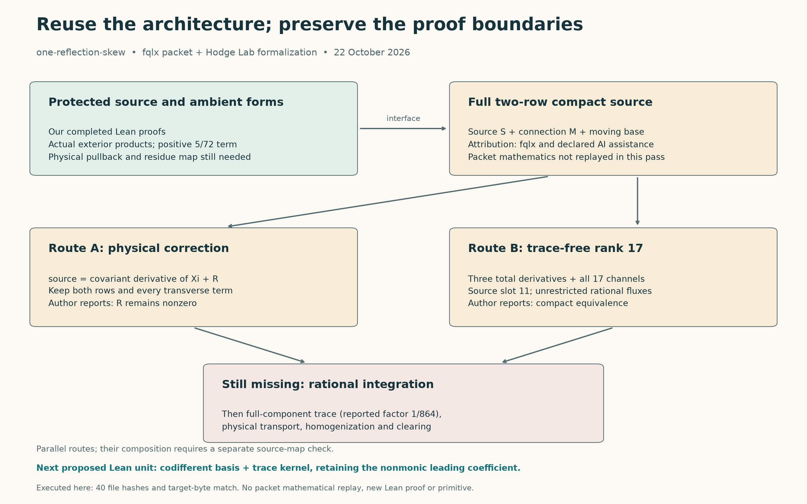

# Reusing the compact-source architecture without conflating its layers

22 October 2026. **Adopt the explicit source/correction/remainder and
connection/transport interfaces.** The new rank-17 presentation is a useful
formalization target; copying it does not construct the missing primitive.
This is a bounded architecture assessment and monitoring update, not a new
replay of the research packet or a Lean proof of its claims.



## Pinned evidence and what we actually checked

The new [fqlx reply 19113830](https://github.com/hodge-computer/sextics/discussions/127#discussioncomment-19113830)
was posted at 03:08:57 UTC on 22 October (23:08:57 EDT on 21 October).
We read it with its parent and the preceding source/kernel update.
The [packet revision](https://gist.github.com/fqlx/1d83052f07e2898ef493a52c86a2180b/455deb68009f99b3da2cae7b68d30dd5ed5df82f)
is `455deb68009f99b3da2cae7b68d30dd5ed5df82f`. Its archive SHA256 is
`d067112d6a859e2fb83d8139eb4de9fe410982ab593d1c77fee77602e72df449`.

Our [integrity checker](../scripts/check_rank17_packet_inventory.py) confirms
the 96,076-byte archive, all **40 file hashes** (436,183 unpacked bytes),
and an exact match between the packet's protected `instance.rec` and our
existing target pin. Its SHA256 is
`fc7e070e4f459a521e3515c3b0d7e85fe4a557e345839f9cdb324491c289063f`.
[Executed integrity receipt](../results/skew-compact-architecture/packet-integrity.json).
We inspected the three principal READMEs and stored reports. **No packet
mathematical script was executed.** Matching hashes authenticate the bytes;
they do not verify the mathematical claims.

The reported 22 exact physical-current checks, 16 rank-17 audit checks,
102 derivative-column tests and six curvature-matrix tests remain
**author-reported evidence**. The latter tests use two finite-field points,
not a characteristic-zero rational-solvability calculation. The packet
itself distinguishes generic algebraic arguments from those implementation
tests. It claims no Lean certificate or `HasCertificate` theorem.

Our completed [actual differential-form proof](skew-differential-forms-lean.md)
at notebook parent `824a5ba427eed35cd2c6ab4504612390533f2f2c` remains
unchanged. Its 13 theorem audits and kernel replay are separate evidence;
they do not verify the packet's compact connection or rank-17 reduction.

## The architecture to reuse

| Layer | Explicit data/contract | Present status |
| --- | --- | --- |
| Protected chart | Fixed F, A, q; coordinate order; physical volume; actual ambient form | Our existing substitution, coefficient and exterior-product Lean proofs; physical pullback/residue interface still incomplete |
| Compact source | Both rows of S, the full connection M, moving base derivatives and volume | fqlx's pinned packet; not replayed in this pass |
| Partial correction route | A concrete two-form Xi and an identity source = covariant derivative of Xi + full remainder R | Author reports a rational physical identity with **nonzero remainder**, including transverse terms |
| Rank-17 route | Entire finite étale algebra, trace-free basis, all three connection matrices, source in slot 11 | Author reports equivalence to the unrestricted **compact** problem; arbitrary rational coefficient functions remain unknown |
| Integration and return | A primitive, evaluation on every required component, normalized trace, physical transport, homogenization and clearing | Primitive remains missing; a legal homogeneous certificate and protected theorem are not supplied |

The correction and rank-17 constructions are **parallel tools for the compact
source**, not a proved sequence in which the first automatically simplifies
the second. If we apply the rank-17 map to the corrected remainder, that
additional source-map identity must itself be checked.

For the correction route, preserve the entire reported remainder

\[
R=\mathfrak r C-B_0J_cD_jH-fJ_dD_jC.
\]

The physical motion of j, including s=t² and d=1+s³, contributes the last
two terms. Integrating a slice with j frozen would not prove the claimed
physical identity. A nonzero removed contribution is progress on a current,
not proof that the remaining source is exact or smaller in a norm.

For the rank-17 route, use all three unknown rational vectors in

\[
(\partial_L+A_L)y_L+(\partial_D+A_D)y_D+
(\partial_z+A_z)y_z=\kappa_{\rm src}\,\mathbf e_{11}.
\]

Here slot 11 is zero-indexed. Seventeen is the rank of the trace-free
module, **not** a bound giving seventeen unknown scalar constants. These
are unrestricted rational functions on the stated algebraic base. A sparse
source does not make the connection sparse or the integration automatic.

The source is trace-free, so taking its ordinary trace gives zero. It does
not eliminate that source: all seventeen trace-free channels are retained.
The packet's converse uses subtraction of Tr(xi)/18 to remove a closed
scalar-trace component from a primitive. This is an existence equivalence,
not a claim that all primitives are uniquely determined after forgetting
that component.

The reported return normalization is 1/(72·12)=1/864: the whole auxiliary
rank-72 trace followed by the rank-24 projector whose trace is 12 times the
identity. It is not inferred merely from a single covering degree; all
components and scalarization identities remain proof obligations for us.

## Names must not silently identify different mathematical objects

| Existing notebook/earlier notation | New packet notation | Proposed explicit name in a future module |
| --- | --- | --- |
| G=z_Y2⁶+P(U), our ambient chart polynomial | G(delta), a nonmonic degree-18 algebra polynomial | `ambientSexticChart` / `coverPolynomial` |
| z is the physical Y2 chart coordinate | z is a torsion-point coordinate on the CM base | `physicalZ` / `cmZ` |
| delta may mean the cubic discriminant in the parent | delta is a degree-18 algebra generator; e1−e2 in the trace tower | `cubicDiscriminant` / `rootDifference` |
| D is our normal derivation, or a certificate denominator | D is a base coordinate with D⁶=d | `normalDerivation` / `certificateDenominator` / `baseSixthRoot` |
| K is our ambient field | K is the source scalar in the displayed rank-17 equation | `AmbientField` / `sourceScalar` |
| S is a scalar Hermite correction in the parent | S is the full two-row compact source here | `hermiteCorrection` / `compactSource` |
| L occurs in the earlier elliptic companion | L is an ordered-root ratio on the CM base | `companionParameter` / `rootRatio` |

In particular, our normal derivation does not descend unchanged to G=0;
it cannot stand in for the base or covariant derivatives in this new system.
The new base includes gamma⁶=256L(L−1), s³=D⁶−1 and y²=−D4(z,L).
All induced derivatives and denominator-unit hypotheses have to be carried
through. A finite étale algebra may be reducible; selecting one numerical
sheet would lose the whole-component transport requirement.

## Smallest useful next Lean unit

Start with a **codifferent trace-free basis theorem**, rather than importing
three large matrices as unexplained constants. For a characteristic-zero
base field and a degree-18 separable polynomial H with leading coefficient
a18≠0, establish the finite-algebra presentation and invertibility of H'(delta).
Then prove, in the entire finite algebra,

\[
e_i=\frac{\delta^i}{H'(\delta)},\qquad
\operatorname{Tr}(e_i)=0\ (0\leq i\leq16),\qquad
\operatorname{Tr}(e_{17})=1/a_{18}.
\]

Together with independence of all eighteen e_i and Tr(1)=18, this identifies
e0,…,e16 as a basis of the trace kernel and provides a trace-free slot e11
for the proposed source. Binding the literal physical source to that slot
requires its separate source-map and normalization checks.
The leading coefficient is essential: the packet's polynomial is not monic.
Separability, dimension, the correct derivative, the coefficient-field map,
and source normalization are hypotheses to prove or instantiate, not facts
established by the archive hash or by the number 17. **No such new theorem
has been implemented or checked in this pass.**

For the concrete instantiation, the smallest missing certificate to request
or reconstruct is a generic Bézout identity for the literal H and H',
over the stated coefficient field and localization. The two good modular
points do not provide that characteristic-zero identity. Monic-normalizing
H for the quotient is possible, but the basis above must still use the
original H' or explicitly account for its leading-coefficient rescaling.

After that unit, define the base derivations on the actual finite algebra,
prove trace compatibility, and derive the matrix columns from differentiating
the basis. Preserve connection corrections and total derivatives. The missing
physical pullback/residue interface from our current forms proof remains a
separate prerequisite to connecting this architecture all the way to F and A.

## Reproduction, limits and attribution

Download `bundle.json` and `payload-001.b64` at the pinned gist revision.
From the notebook root, run:

```sh
python3 -O scripts/check_rank17_packet_inventory.py --packet-dir /path/to/gist-files --output /path/to/integrity.json
python3 scripts/visualize_skew_compact_architecture.py
```

The integrity checker fails on a mismatching archive/member/target and runs
without executing packet code. The [receipt and monitor record](../results/skew-compact-architecture/monitor-receipt.json)
pin the source material, scope and bounds. The diagram is an architecture map
generated from the recorded layer statuses, not mathematical verification.

Credit **fqlx (Ben Burns)** and the declared ChatGPT/agent assistance for
the new constructions and packet; Benjamin E. Diamond and contributors for
the protected problem and framework. Earlier credit to rbajaj5 in the parent
is already recorded, not new credit in this update. We retain the packet's
distinction between separate computational implementations and human review.

Upstream heads and acceptance records are unchanged in this monitor;
`one-reflection-skew` remains open. No upstream post, reply, edit or PR was
made. The Posts list and contribution tally remain 29.
