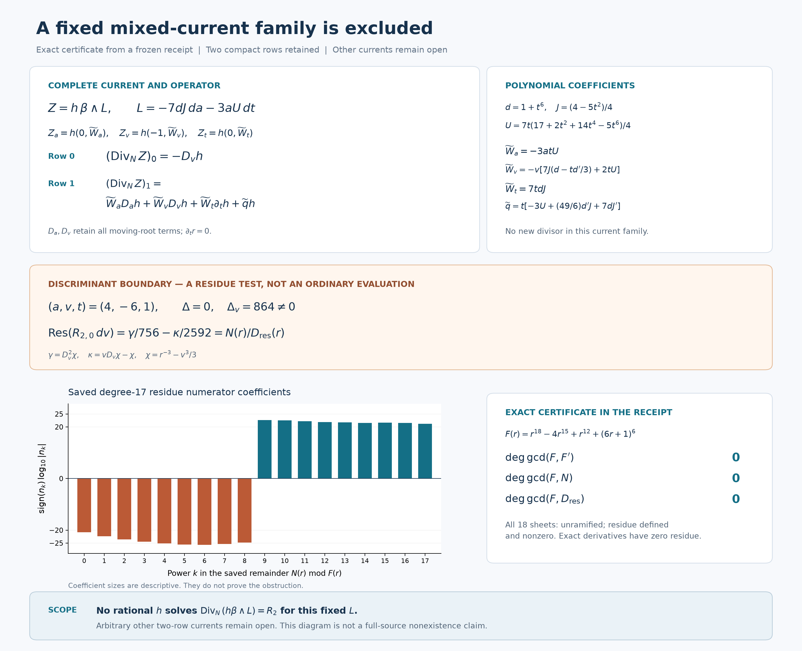
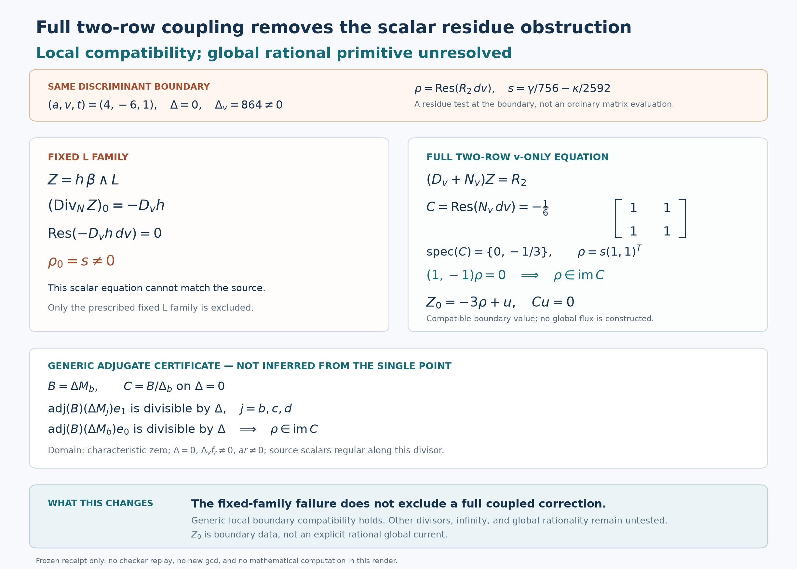
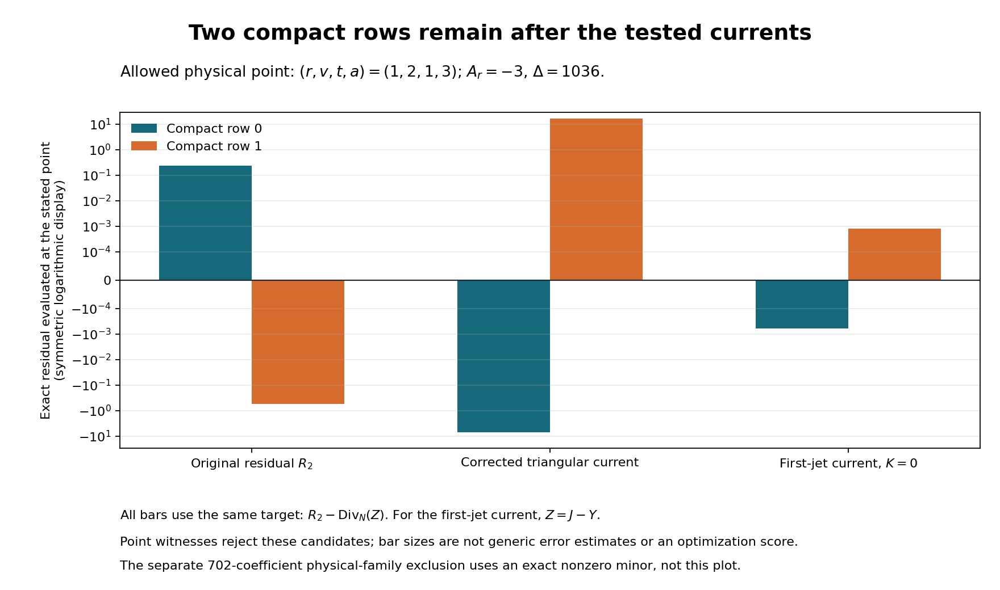

# One-reflection-skew: full-residual cancellation attempts

24 October 2026. **The full primitive remains missing.** This bounded batch
tries to cancel the actual two-row compact residual. Lean is benched at the
user's direction. Claims below concern rational compact coefficients, not
arbitrary fibre-dependent functions or a homogeneous certificate.

## Fixed inputs and run card

- Notebook parent: `84f294e0235c3fd4b5d4849e565536172a74329c`.
- Upstream dispatch pin: `27f4bb9ad8757e5841f884d9d30124a3c97a847d`.
- Target unchanged: `one-reflection-skew`, `q=1`, `A=X_0^3 Y_0^3`.
- Reused inputs: [checkpoint 146's centered Q/R2 and beta calculations](skew-mixed-current-20261024.md).
  These completed calculations were not commissioned again.
- Pinned connection: the existing [packet JSON](../results/skew-physical-source-20261023/inputs/benediamond/packet/one-reflection-skew-followup/inputs/source-rank2-connection.json),
  SHA256 `a86c01f7fed725aac86e958a10f484b9b340765714c5b228513890977a59ce5d`.
- Actual Goal started 15:15:22 UTC. Research bound 45 minutes, symbolic
  processes at most 60 seconds, network operations at most 45 seconds,
  integration allowance 15 minutes. A completed batch does not solve the target.
- Roles: existing Pro chat constructive lead; complementary local algebra
  worker; distinct exact checker; coordinator owns integration and ledger.
- Acceptance: an explicit full cancellation, or an exact failed candidate
  or precisely excluded family that changes the next constructive decision.

Use the packet's positive residue convention and input-column matrix convention.
The compact coefficient field is

\[
 K=\mathbb Q(a,v,t)[r]/(f),\qquad
 f=r^{18}+r^{12}+(vr-1)^6-ar^{15},
\]

equivalently rational physical coordinates `(r,v,t)` with
`a=A(r,v)=r^3+r^-3+(vr-1)^6/r^15`. The scalar multipliers below belong to
this field. They do **not** range over arbitrary functions of the fibre
coordinates `V,nu` in the entire sextic function field.

The ordered compact basis is `(dV/nu^5,V dV/nu^5)`. Put
`b=tv`, `c=t(1-t^2)/7`, `d=1+t^6`, and

\[
 N_a=M_a,\quad N_v=tM_b,\quad N_t=vM_b+c'M_c+d'M_d.
\]

The derivatives `D_a=partial_a+r^15 partial_r/f_r` and
`D_v=partial_v-f_v partial_r/f_r` retain the moving-root terms; `D_t r=0`.
The common ordinary chart excludes the actual denominators, including
`r f_r a Delta=0`. A discriminant residue test below is explicitly a
boundary calculation, not substitution of a singular connection value.

Reuse `chi=r^-3-v^3/3`, `gamma=D_v^2 chi`, `kappa=vD_v chi-chi`, and

\[
 B=\operatorname{Div}_N Q+R_2,\qquad
 R_2=\alpha\gamma+\beta\kappa,
\]
\[
 \alpha=\frac{N_t e_1+v e_0/(3a)}{36t},\qquad
 \beta=\frac{M_b e_0}{108a}.
\]

These are two-component vectors. Their apparent t denominator is removable
as established in the reused audit. Trace zero is not the cancellation test.

## A new polynomial mixed-current family, and why it fails

The first attempted new direction was the physical tangent lift of the two
universal coefficient-Euler scalings. Its exact comparison gives
`T=(3ad/t)W`, where W is the already-used beta direction. This does not
provide a transverse direction. The rank-one statement is restricted to
those two scalings; it does not exhaust vectors annihilating a single
connection entry, or arbitrary mixed currents.

A genuinely different construction uses the vector-valued one-form

\[
 \beta_0=-\frac c{3a}da+\left(c'-\frac{2cd'}{3d}\right)dt,
\]
\[
 \beta_1=-\frac{2tv}{3a}da+t\,dv+
 v\left(1-\frac{td'}{3d}\right)dt.
\]

Here `beta_0,beta_1` are components of the beta **one-form**, distinct from
the coefficient vector beta in R2. The one-form is twisted closed:
`nabla beta=(d'/(6d)) dt wedge beta`.

Define

\[
 P=t^8-3t^6-3t^2+1,\quad J=(4-5t^2)/4,
 \quad U=7t(17+2t^2+14t^4-5t^6)/4.
\]

The exact polynomial identity `cU+PJ=1` gives

\[
 L=-7dJ\,da-3aU\,dt,\qquad \beta_0\wedge L=da\wedge dt.
\]

For arbitrary rational `h in K`, set `Z=h beta wedge L`. Its complete
cyclic fluxes, in order `(dv wedge dt,dt wedge da,da wedge dv)`, are

\[
 Z_a=h(0,\widetilde W_a)^T,\quad
 Z_v=h(-1,\widetilde W_v)^T,\quad
 Z_t=h(0,\widetilde W_t)^T,
\]

where

\[
 \widetilde W_a=-3atU,\quad
 \widetilde W_v=-v[7J(d-td'/3)+2tU],\quad
 \widetilde W_t=7tdJ,
\]
\[
 \widetilde q=t[-3U+(49/6)d'J+7dJ'].
\]

The full connection, including its cross-row terms, gives

\[
 \operatorname{Div}_N Z=
 \begin{pmatrix}
 -D_v h\\
 \widetilde W_aD_a h+\widetilde W_vD_v h+
 \widetilde W_t\partial_t h+\widetilde qh
 \end{pmatrix}.
\]

L and this scalar operator introduce no new denominator divisor. An
arbitrary choice of h can of course have its own poles. Both compact rows
and all three base directions are retained in the displayed family.

### An explicit trial fails at an ordinary point

Write `R2_0=A0 gamma+B0 kappa`, where A0 and B0 are component zero of
the coefficient vectors alpha and beta. The integration-by-parts choice

\[
 h_0=-A_0D_v\chi-(vB_0-\partial_vA_0)\chi
\]

leaves first row

\[
 (\partial_v^2A_0-2B_0-v\partial_vB_0)\chi.
\]

At the allowed cover point `(r,v,a,t)=(1,2,3,1)` this equals
`-10400225/29553138279`, exactly nonzero. The complete second row remains
`R2_1-(Wtilde_a D_a h0+Wtilde_v D_v h0+Wtilde_t h0_t+qtilde h0)`;
it is not silently discarded. This ordinary-point witness rejects h0.

### A relative residue excludes every h in this fixed family

There is a stronger obstruction to this **fixed L**, independent of bounds
on the degree or poles of h. At `t=1,a=4`,
`Delta=8(v^3+216)`, with the simple root `v=-6` and `Delta_v=864`.
Taking residues before restricting to the divisor gives

\[
 \operatorname{Res}_{v=-6}(R_{2,0}\,dv)
 =\gamma/756-\kappa/2592.
\]

The author evaluates this rational residue on the actual cover

\[
 F(r)=r^{18}-4r^{15}+r^{12}+(6r+1)^6.
\]

For the saved cleared numerator N and denominator D_res, exact rational
polynomial gcds give

\[
 \gcd(F,F')=\gcd(F,N)=\gcd(F,D_{\rm res})=1.
\]

Thus the cover is unramified here and the residue is defined and nonzero
on all eighteen sheets. The separate checker uses a different calculation:
implicit first/second root derivatives and exact reduction modulo 32003.
It obtains a nonzero degree-17 residue class and checks every inverted
factor. This independently certifies characteristic-zero nonvanishing on
at least one sheet; it is not presented as a second all-sheet gcd proof.

This evaluates the known generic residue function, not a hypothetical h
that might have parameter poles. On the relative discriminant divisor over
Q(a,t), the tested residue is regular on the stated etale open and has a
nonzero allowed specialization. It therefore is not identically zero.
An exact relative differential `D_v h dv` has zero residues in the local
parameter `v-v0`. Consequently **no rational h in K satisfies
Div_N(h beta wedge L)=R2 for this L**. Other choices of L, other mixed
currents, and the full target remain open. Increasing h's degree or pole
order within this family cannot repair it.

The [figure source and reproduction instructions](../results/skew-full-residual-20261024/algebra/visualization)
read the frozen receipt. The coefficient-size plot is descriptive; the
exact gcd certificates, not bar heights, support the obstruction. The image
was inspected. A failed first rendering is retained separately from the
successful second rendering; neither is a mathematical run.

## Further constructive handoff

The reused Pro chat received this obstruction and was redirected to broader
two-row currents. Its [first triangular handoff](../results/skew-full-residual-20261024/pro-handoff-01.md)
was sent to the separate checker. The initially displayed contraction has
a sign error: at `(a,v,t)=(3,2,1)` its claimed zero lower-left matrix entry
is actually `4104/1813`. The failed draft is preserved. No triangularity or
full cancellation is inferred from that draft.

Exactly one explicit repair was supplied and tested. Write

\[
 C=t(1-t^2)/7,\quad D=1+t^6,\quad K_0=C^2-3tvD,
\]
\[
 w=CC'-2tvD',\quad q=3DC'-2CD',
\]
\[
 G_v=-tvw+3aq+2vK_0,\quad G_t=-2tK_0.
\]

The repaired contraction is

\[
 \Gamma=G_vN_v+G_tN_t=
 \begin{pmatrix}3tw/2&-tq\\0&tw/2\end{pmatrix}.
\]

Let `calD=G_v partial_v+G_t partial_t`,
`Kmat=(partial_v G_v+partial_t G_t)I+Gamma`, and

\[
 S=\alpha/G_v,\qquad T=(v\beta-\mathcal D S-K_{\rm mat}S)/G_v.
\]

The full two-row current is

\[
 J_a=0,\quad J_v=G_v(SD_v\chi+T\chi),\quad
 J_t=G_t(SD_v\chi+T\chi).
\]

Since chi_t=0 at fixed a,v, its exact remainder is

\[
 R_2-\operatorname{Div}_N J
 =\chi(-\beta-\mathcal DT-K_{\rm mat}T).
\]

Both rows are retained. At `(r,v,a,t)=(1,2,3,1)`, `G_v=-108/7`,
`G_t=24`, and the checked full remainder is

\[
 \left(-\frac{242298600715}{34686091188},
        \frac{255188727685}{15416040528}\right)^T.
\]

Thus repairing the matrix identity does not repair full cancellation. This
candidate also introduces a G_v denominator divisor. No further repair of
this specific construction was commissioned after that exact failure.

### A simpler comparator also fails

The coordinator proposed the same two-row integration by parts with
`G_v=1,G_t=0`, which does not add that divisor:

\[
 T_0=v\beta-\partial_v\alpha-N_v\alpha,\qquad
 J_v=\alpha D_v\chi+T_0\chi,\quad J_a=J_t=0.
\]
\[
 R_2-\operatorname{Div}_N J
 =\chi[-\beta-\partial_vT_0-N_vT_0].
\]

Its full remainder at the same allowed point is

\[
 \left(\frac{70505}{312731622},
       -\frac{637135}{1250926488}\right)^T.
\]

The separate checker used exact rational second-order jets before point
evaluation, cross-checked against symbolic derivatives. In particular t was
not specialized before differentiating the triangular construction.
The coefficient vectors of both constructions lie in Q(a,v,t), so the
centering transfers to their currents and remainders. This conclusion does
not apply to arbitrary root-dependent multipliers.

The resulting chi-times-base-vector expressions contain no f_r denominator
in their coefficient vectors. That is **not a newly discharged bottleneck**:
even the earlier direct integration of `B=-chi_a M_b e0/36` gives current
`(-chi M_b e0/36,0,0)` with residual
`chi*(partial_a M_b+M_a M_b)e0/36`. Ben'ediamond's earlier H/L reduction
also removed A_r poles. The new point tests reject these displayed trial
currents; they do not establish wider coverage or exclude general mixed
currents merely because their formulas have changed.

## Coupled residue compatibility

The fixed-L failure suggested testing whether its residue obstruction
persists for all coupled v-direction currents. The answer at the tested
boundary point is **no**. Independently of the fixed-L constraint,

\[
 \operatorname{Res}(N_v\,dv)=-\frac16
 \begin{pmatrix}1&1\\1&1\end{pmatrix},\qquad
 \operatorname{Res}(R_2\,dv)=s(1,1)^T,
\]

where `s=gamma/756-kappa/2592`. The residue matrix has eigenvalues
`0,-1/3`. Its left-kernel vector `(1,-1)` annihilates the source residue,
and the regular leading value `Z0=-3s(1,1)^T` satisfies
`Res(N_v dv) Z0=Res(R2 dv)`.

This is a checked local compatibility condition. It shows why the fixed-L
obstruction cannot be promoted to all v-only two-row currents. A compatible
leading value is not a global rational current or a full primitive.

### Generic compatibility, checked without specializing the parameters

The author and separate checker extended that observation by universal
polynomial identities. Write `Bmat=Delta M_b`, `Delta_b=partial_b Delta`
and `H=bd-c^2/12`. They check

\[
 \operatorname{tr}B_{\rm mat}=-\Delta_b/3,\qquad
 \det B_{\rm mat}=\Delta H,
\]
\[
 B_{\rm mat}^2+(\Delta_b/3)B_{\rm mat}=-\Delta H I.
\]

The four exact image certificates are

\[
 \operatorname{adj}(B_{\rm mat})(\Delta M_b)e_0=\Delta(H,0)^T,
\]
\[
 \operatorname{adj}(B_{\rm mat})(\Delta M_b)e_1=\Delta(0,H)^T,
\]
\[
 \operatorname{adj}(B_{\rm mat})(\Delta M_c)e_1=\Delta(H,0)^T,
\]
\[
 \operatorname{adj}(B_{\rm mat})(\Delta M_d)e_1
 =\Delta(-3ad/2-bc/3,-3ac/4)^T.
\]

On `Delta=0`, with `Delta_v=t Delta_b !=0`, the residue matrix is
`Cres=Bmat/Delta_b`. It has rank one and satisfies `Cres^2=-Cres/3`.
The regular extra e0 term in alpha has zero residue. The displayed image
identities therefore place the **entire** source residue rho in the image
of Cres, with `Cres rho=-rho/3`. Thus `Z0=-3rho+ker(Cres)` supplies
compatible leading data generically on this part of the divisor.

This uses characteristic zero and `a,r,f_r !=0`, so the source scalars
gamma and kappa are regular along the divisor. It makes no assertion at
ramification intersections, v-tangencies, a=0 or other excluded loci.
The generic assertion follows from polynomial divisibility, not inference
from the single point above.

For a v-only rational correction, a pole of order m>=1 would require
`(Cres-m I)Z_-m=0`. Its eigenvalues `0,-1/3` exclude such poles. A solution
must instead be regular and satisfy `Cres Z0=rho`, which is compatible.
At higher formal orders, `n I+Cres` is invertible for every n>=1. This
gives a local formal power-series solution after compatible initial data
are chosen. It does **not** prove that the series is a rational function,
or handle other divisors or infinity. The useful next condition is the
required boundary value for a coupled current; a nonzero scalar residue
alone is not an obstruction to that current.

This [second visualization](../results/skew-full-residual-20261024/algebra/v-only-local/visualization)
reads the frozen coupled-residue receipt and records the actual reason the
team moved to the broader equation. Its matrix and domain are explicit;
the picture does not assert a global current. Generator, input/output
hashes, first-render failure and final inspection are retained.

## Executed evidence and remaining limits

New mathematical executions use exact Python/SymPy algebra or exact
prime-field arithmetic by AI agents, not independent human reviews or
Lean/kernel runs. Source and
script hashes are retained in the result directory. Counts belong to their
individual scopes and are not summed into a measure of solved targets.

| Execution | Outcome and scope |
| --- | --- |
| [Author fixed-L check](../results/skew-full-residual-20261024/algebra/check-01/validation.json) | 15 exact checks, two mutation controls; 2.937 seconds. Full operator, exact residue and rational all-sheet gcd witness. |
| [Separate h0 test](../results/skew-full-residual-20261024/checker/complementary-row0.json) | Formal first-row identity, exact ordinary-point failure and sign control; 1.156 seconds. |
| [Separate fixed-L check](../results/skew-full-residual-20261024/checker/complementary-operator-residue.json) | 11 checks and one sign control; 1.547 seconds. Full operator and good modular certificate of characteristic-zero residue nonvanishing. |
| [Repaired Pro triangular current](../results/skew-full-residual-20261024/checker/triangular-repair.json) | 13 checks and one sign control; 3.297 seconds. Correct contraction and exact nonzero full point residual. |
| [Simpler comparator](../results/skew-full-residual-20261024/checker/v-only-comparator.json) | Eight checks and one sign control; 1.531 seconds. Full formal identity and exact nonzero point residual. |
| [Author coupled residue check](../results/skew-full-residual-20261024/algebra/v-only-local/check-01/validation.json) | 15 new checks, two mutation controls; 2.359 seconds. Generic polynomial image certificates and compatible boundary data. Prior scalar gcds were reused, not rerun. |

The separate checker also executed eight local coupled-matrix checks and
one control in 1.109 seconds, followed by 13 generic polynomial checks and
one control in 1.235 seconds. Those reports and bounded replay commands are
listed in its [README](../results/skew-full-residual-20261024/checker/README.md).
The latter run uses universal coefficient polynomials and does not repeat
the point or gcd calculation.

The first expanded scalar calculation reached its 58-second watchdog;
the saved timeout supplies no mathematical evidence. Exact point jets
replaced the expensive expansion for rejecting an explicit candidate.
The initial Pro triangular handoff failed its matrix equality before its
residual could be accepted. That failed source, log and receipt remain;
the separately named repaired checker does not overwrite them.

The coordinator's suggestion that the older Pro t-only exclusion concerned
only a scalar beta current was incorrect. Reading the saved prior report
showed it already concerned the full two-vector equation at fixed
`(a,v,r)=(3,2,1)`, with degree bounds `(3,1)` and ranks 6/7. This was
corrected to Pro before reuse. The older result remains **Pro-reported,
not locally replayed**, as documented in checkpoint 146. The local
discriminant compatibility here does not contradict a global fixed-point
rational obstruction, or turn that older reported computation into new work.

## Pro's delivered full-source search

The reused [Pro chat](https://chatgpt.com/c/6adb94ec-665c-8325-9a4b-2b4237c63f19)
stopped mathematical construction at 15:32:59 UTC and delivered a fresh
107-file packet. Its [original note](skew-mixed-construction-20261024.md)
and scripts, failed runs and receipts are retained byte-for-byte. The ZIP
SHA256 is `9441abd9f0aea4454bd98bf98c21e280ebf58d701d9fd54911b170a29432009d`;
the [import receipt](../results/skew-full-residual-20261024/pro-delivery/import-validation.json)
checks every manifest member. Receipt verification is separate from the
local mathematical replays described below. Pro did not commit or push;
the coordinator integrates its shared-file changes and ledger.

### Direct physical Laurent family

This tests the original full physical source, rather than pretending that
the same coefficient bounds are unchanged by subtraction of Q. In physical
coordinates the equation is

\[
 \sum_{i=r,v,t}(\partial_i+\widetilde N_i)F_i
 =r^{-4}M_be_0/12,\qquad
 \widetilde N=(A_rM_a,A_vM_a+tM_b,N_t).
\]

Each of the six scalar components of F is independently allowed to be in

\[
 \operatorname{span}_{\mathbb Q}
 \{r^m v^n t^k:-10\le m\le2,\ 0\le n,k\le2\}.
\]

There are 702 unknown constant coefficients. Both compact output rows,
the physical chain term A_v M_a, all three derivatives and the entire
t-connection remain in the operator. This is a finite Laurent family,
with no additional finite pole support. It is not all rational currents.

Pro's 762-row evaluation matrix has an augmented 703-by-703 minor with
determinant **13884 modulo 32003**. Nonzero reduction proves that this
fixed rational minor is nonzero in characteristic zero: the source column
cannot belong to the span of the 702 coefficient columns. This reasoning
does not require denominators of hypothetical solution coefficients to be
prime to 32003. The exclusion persists under extension of the constant
field, while allowing coefficients rational in r,v,t would change the
declared family and is not excluded.

The [standalone verifier](../results/skew-mixed-construction-20261024/reproduce_laurent.py)
requires only NumPy and the pinned connection JSON, not a saved sample
matrix. No containment claim relative to fqlx's earlier 504-column screen
or any other earlier search is made.

The separate local checker replayed the supplied Pro verifier unchanged
in 3.360 seconds, then used independently written rational-polynomial
evaluation, symbolic physical derivatives and normalized Gaussian
elimination to reconstruct the decisive 703-by-703 minor. All 494,209
entries agreed and its determinant was again 13884 modulo 32003, in
2.687 seconds. Omitting A_v M_a changed a tested entry and was detected.
This is a check of the decisive minor, not a replay of all 762 rows.
The [local Laurent audit](../results/skew-full-residual-20261024/checker/laurent)
separates the supplied-code replay from the independently written audit.

### A specific mixed v,t family

Pro also tested, with an arbitrary base-rational two-vector K(a,v,t),

\[
 J_a=0,\quad J_v=\frac{\chi_v e_1}{36t^2}
                   -\frac{\chi M_a e_0}{36t},\quad J_t=\chi K.
\]

With `T0=(partial_b M_a+M_b M_a)e0/36`, its full equation is
`Div_N J-R0=chi*((partial_t+Nt)K-T0)`. Subtracting the reused Y gives the
corresponding candidate Z=J-Y for R2; it retains both rows and root motion.
The [Pro family account](../results/skew-mixed-construction-20261024/alternate/HANDOFF.txt)
explains why no rational K can complete these fixed a/v fluxes: generic
finite poles are at most simple along Delta, and an infinity gauge bounds
the numerator degrees of K=P/monic(Delta) by (15,13). The specialized
52-by-30 system at (a,v)=(3,2) has exact coefficient/augmented ranks 30/31.
Full column rank there supplies the Cramer regularity argument needed to
exclude a generic solution with a specialization pole. This family is
different from the earlier pure-t R2 calculation, which was not rerun.

A separate local worker replayed the unmodified Pro recurrence checker
in 2.719 seconds. It reconstructed the 52-by-30 matrix, matched every
entry, and verified an exact left-null inconsistency witness. This is
an independently executed **Pro-code replay**, not a newly authored
implementation. The worker separately reviewed the finite-pole, infinity
and Cramer reasoning. Its [review and replay](../results/skew-full-residual-20261024/algebra/review-pro)
keep those evidence types distinct. No independence of the actual chi jets
is assumed: the displayed remainder is chi times a base coefficient and
chi is a nonzero element of the physical coefficient field. No additional
generic structure-checker execution is claimed locally.

Neither exclusion proves a failure of general multidirectional compact
currents. In particular, the generic local image compatibility above is
consistent with both: local compatible series need not be global rational
solutions, and a constrained global family can still fail.

The Pro figure was also inspected locally. It displays exact point
witnesses using a symmetric logarithmic scale. Smaller bars do not measure
progress toward a global primitive. Its generator, input/output bindings
and earlier rendering remain in the delivered packet.

## Final outcome and verification boundary

No full cancellation or rational primitive was found. The completed batch
rules out specified routes and identifies compatible local boundary data;
it does not claim source exactness, a fibre-exact lift, global clearing,
a homogeneous certificate or an accepted solve. No Lean was written or run.
The next constructive decision must change a restriction in a failed
family while checking the same full source. An additional justified pole
support in the six-component physical family is a possible test, not a
result of this batch.

Constructive and mathematical checking work closed at 15:44:42 UTC,
29 minutes 20 seconds after Goal activation and within the 45-minute bound.
Subsequent work is artifact binding, append-only integration and publication.

Packaging found a log-hash convention mismatch in several local receipts:
they hash LF subprocess text, while Windows text-mode writes saved CRLF
logs. The original logs and receipts are preserved. The integration record
checks the LF-normalized text and separately records the actual raw-byte
hashes; it does not describe those receipt fields as raw-byte matches.
Source scripts and mathematical JSON receipts remain byte-bound. This
packaging correction required no rerun of the mathematics.

Credit fqlx for the compact connection, benediamond for the physical cover
and earlier source reductions, and Benjamin E. Diamond and hodge.computer
contributors for the fixed problem and framework. New constructions,
checks and failed attempts here are AI-assisted work for Ravi Bajaj.
The [ledger](../LEDGER.md) records checkpoint 147. No upstream post or
substantive edit was made; Posts 1–29 and the contribution tally are unchanged.
