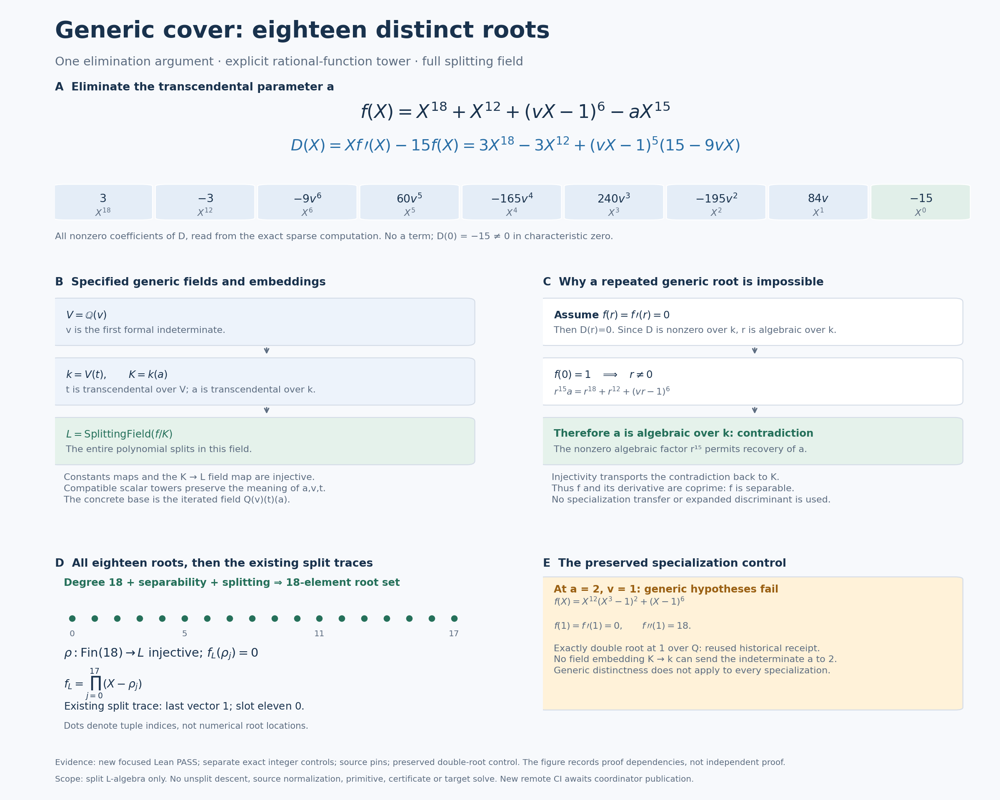

# Generic distinct roots for the one-reflection-skew cover

23 October 2026. **Pro mathematics, independently reviewed and integrated by
the Goal-enabled coordinator for Hodge Lab publication.** This unit starts
at notebook parent `bf0c69287865ba00d3e651cdbc4d0f881deba4db`, with upstream
pinned at `b790130d43b49ec0ddc6865d0bdc949eeeee2319`. Both heads were fetched
live. The existing Pro chat performed the mathematics; the coordinator
activated Goal, reviewed and applied the handoff, and owns Git publication.
There is no upstream post, edit or PR in this unit.

The new [Lean module](../formal/HodgeLab/OneReflectionSkew/GenericDistinctRoots.lean)
constructs all eighteen distinct roots of

\[
f(X)=X^{18}+X^{12}+(vX-1)^6-aX^{15}
\]

in its specified splitting field over the explicit generic base
\(K=\mathbb Q(v)(t)(a)\). It supplies the root data previously assumed by
[the conditional physical binding](skew-physical-cover-binding.md).
The full module compiled locally and the final focused checker passed
48 public declaration audits, one new-module kernel replay, nine grouped
positive interface controls and three intended negative controls.



## The precise theorem and coefficient fields

Use three successive rational-function fields:

| Lean name | Mathematical field or element | Independence statement |
| --- | --- | --- |
| `VField` | \(V=\operatorname{RatFunc}(\mathbb Q)=\mathbb Q(v)\) | `v_transcendental`: \(v\) is transcendental over \(\mathbb Q\) |
| `CoeffField` | \(k=\operatorname{RatFunc}(V)=\mathbb Q(v)(t)\) | `t_transcendental`: \(t\) is transcendental over \(V\) |
| `BaseField` | \(K=\operatorname{RatFunc}(k)=\mathbb Q(v)(t)(a)\) | `a_transcendental`: \(a\) is transcendental over \(k\) |
| `genericPolynomial` | \(f\in K[X]\), using the literal prior definition | `generic_separable` and `generic_degree` |
| `SplitField` | \(L=\operatorname{SplittingField}_K(f)\) | The full polynomial splits after the canonical embedding \(K\hookrightarrow L\) |

Each field has characteristic zero. This is an explicit iterated
rational-function presentation of the generic field with three independent
parameters. The new proof does not construct a separate isomorphism to a
particular multivariate fraction-field implementation; no such identification
is needed for this permitted presentation. The polynomial does not involve
\(t\), but \(t\) remains an independent parameter of the base field.

`coefficientToBase`, `baseToSplit` and `coefficientToSplit` are the canonical
field homomorphisms. Their injectivity is proved, and
`coefficient_map_compatibility` states that the composite \(k\to K\to L\)
equals the chosen map \(k\to L\). `a_transcendental_in_split` explicitly
transports transcendence through the injective map. The lower parameters
enter \(K\) through its constants map; their images in \(L\) always use
`baseToSplit`.

The resulting declarations provide

\[
\rho:\operatorname{Fin}(18)\longrightarrow L,
\qquad \rho\text{ injective},
\qquad f_L(\rho_j)=0\quad\text{for every }j,
\]

where \(f_L\) is both the mapped polynomial and the literal physical
polynomial evaluated at the embedded parameters. This equality is a named
theorem, `physical_polynomial_map`; it is not left implicit in notation.
The enumeration is noncomputable and uses a finite-set equivalence. It
does not assert a preferred root ordering, numerical approximations, or
that the roots belong to \(K\).

## One exact separability argument

The central theorem is slightly more general: for any characteristic-zero
field \(k\), any field extension \(K/k\), arbitrary \(v\in k\), and
\(a\in K\) transcendental over \(k\), the displayed polynomial is separable.
Thus the proof uses transcendence of \(a\), without requiring \(v\) itself
to be generic.

Set

\[
\begin{aligned}
D(X)&=Xf'(X)-15f(X)\\
&=3X^{18}-3X^{12}+(vX-1)^5(15-9vX).
\end{aligned}
\]

The \(aX^{15}\) terms cancel, so \(D\in k[X]\). Its constant coefficient is
\(-15\ne0\) in characteristic zero. If \(r\) were a common root of \(f\)
and \(f'\) in an algebraic closure of \(K\), then \(D(r)=0\) would make
\(r\) algebraic over \(k\). Also \(f(0)=1\), so \(r\ne0\). The root equation
gives

\[
r^{15}a=r^{18}+r^{12}+(vr-1)^6.
\]

The right-hand side and \(r^{15}\) are algebraic over \(k\), and
\(r^{15}\ne0\). Mathlib's `IsAlgebraic.of_mul` therefore makes the image of
\(a\) algebraic over \(k\). The injective extension map transports this
contradiction back to the original transcendental parameter.

This proves that \(f\) and \(f'\) have no common root in an algebraic
closure. The existing coprimality API converts that fact to separability.
The proof explicitly supplies compatible scalar towers for this passage;
it does not invert a root before proving it nonzero. No expanded
discriminant and no squarefree-specialization transfer is used.

Next, the full splitting-field construction supplies splitting, the prior
physical-degree theorem supplies degree 18, and
`Polynomial.card_rootSet_eq_natDegree` supplies the root-set cardinality.
`Fintype.equivFinOfCardEq` produces the enumeration. Thus a single-factor
root field is never substituted for a field containing all roots.

The exact integer-polynomial [derivation check](../results/skew-distinct-roots-20261023/math-review/check_elimination.py)
independently verifies all nine coefficients of \(D\), cancellation of
\(a\), \(D(0)=-15\), \(f(0)=1\), and the parameter-recovery identity.
It supports the algebraic calculation; the field argument and actual
Lean proof establish separability. See the separate
[mathematical derivation](../results/skew-distinct-roots-20261023/math-review/derivation.md).

## What is now instantiated, and what remains separate

The existing theorem `physical_eq_split_cover` now applies to the constructed
tuple. `generic_eq_split_cover` proves

\[
f_L(X)=\prod_{j=0}^{17}(X-\rho_j)=\operatorname{coverPolynomial}(1,\rho).
\]

The leading coefficient is **1**; the parameter \(a\) is not the leading
coefficient \(a_{18}\). Every \(\rho_j\) and every derivative value
\(f_L'(\rho_j)\) is proved nonzero. `generic_trace_last` and
`generic_trace_slot_eleven` instantiate the previous two trace corollaries
over the split algebra \(L^{18}\):

\[
\operatorname{Tr}_{L^{18}/L}
 \left(\left(\frac{\rho_j^{17}}{f_L'(\rho_j)}\right)_j\right)=1,
\qquad
\operatorname{Tr}_{L^{18}/L}
 \left(\left(\frac{\rho_j^{11}}{f_L'(\rho_j)}\right)_j\right)=0.
\]

The completed split quotient/basis proof is reused as an imported dependency;
its full 18-dimensional basis and 17-dimensional trace kernel are not
reconstructed in this unit. No trace-compatible base change to an unsplit
\(K\)-algebra, unsplit descent, or physical differential-source normalization
is proved. Trace zero is neither a zero-vector claim nor an exactness claim.

The original physical chart remains the canonical \(Y_0=1\) chart, with
\(X_0\ne0\) required for the ratios \(r=X_1/X_0\), \(w=X_2/X_0\), and
\(r\ne0\) for the displayed substitution involving \(r^{-1}\). Those
geometric chart assumptions and the source correspondence are preserved
from the prior note. The generic polynomial theorem does not rederive the
chart or claim a rational primitive, global clearing, `HasCertificate`,
or a target solve.

The smallest next formal bridge, if the research continues toward an
unsplit statement, is the explicit scalar-extension comparison for
\(K[X]/(f)\) and the already formalized split \(L\)-quotient, including
trace compatibility. That is a separate future unit; no part of it was
started here.

## Generic does not mean every specialization

The retained exact historical control at \(a=2,v=1\) is

\[
f(X)=X^{12}(X^3-1)^2+(X-1)^6,
\qquad f(1)=f'(1)=0,\qquad f''(1)=18.
\]

It has an exactly double root at 1 over \(\mathbb Q\). The original
[derivation receipt](../results/ci-receipt-physical-cover-20261023/math-review/derivation-review.json)
and prior failed universal-simple-root Lean control are reused intact.
The new module additionally proves `repeated_specialization` and
`repeated_specialization_not_separable`, furnishing a direct formal
obstruction to an incorrect universal-specialization claim.

There is no contradiction with generic separability: \(a=2\) violates
transcendence over \(k\). There is also no field homomorphism from all of
\(k(a)\) to \(k\) sending \(a\) to 2, because it would send the nonzero
invertible element \(a-2\) to zero. Polynomial specialization is distinct
from the injective field maps used by the theorem.

## Current source pins and preserved prior work

The [source manifest](../results/skew-distinct-roots-20261023/source-pins.json)
retains full Git SHAs, Git blob IDs and raw SHA256s. Upstream generated
`data/one-reflection-skew/record.json` and `data/index.json` are absent at
the new pin after the catalogue migration. The new comparison uses protected
`data/one-reflection-skew/instance.rec` and the authoritative source files.
Its SHA256 is
`c6621c8845addf857ed30726f86449d5ea3310c7609641db9e326f9b85f10fbd`.
Literal `id/F/q/A` agree with the preserved historical instance. Historical
record hashes and receipt pins are not replaced by the new representation.

The original CI-lifecycle repair and conditional binding were published at
[5d216691981cdb248073209bdc80df86021412d4](https://github.com/rbajaj5/hodge-lab/commit/5d216691981cdb248073209bdc80df86021412d4).
The prior [full Lean CI run 40026828482](https://github.com/rbajaj5/hodge-lab/actions/runs/40026828482)
is confirmed successful by a fresh read of its run metadata. That is
**reused prior CI**, not a new remote execution for this unit. The old CI
repair, source-to-Hessian proof, transport, covariant jets, split basis and
catalogue-wide checks were not rerun.

## Process bounds, verification and attribution

The [plan](../results/skew-distinct-roots-20261023/plan.json) was recorded
before computation: start 22:53:18 UTC, 60-minute mathematical/Lean limit,
reassessment at 45 minutes, at most two approaches, 120 seconds per Lean
process and 600 seconds per focused checker. Stop at the first hard bound
with the exact obstruction if incomplete. Only Approach 1, the eliminant
argument, was used; the irreducibility fallback was not started.

The mathematics specialist and read-only adversarial reviewer are separate
AI agents, not independent human reviewers. The sole Lean writer owns the
new proof and checker; this chat's root owns the source comparison,
visualization, note and integrated handoff. Coordinator-reported SymPy
support is recorded [separately](../results/skew-distinct-roots-20261023/coordinator-support-reported.json)
and is not counted as an execution by this chat.

The [final focused receipt](../results/skew-distinct-roots-20261023/lean-development/checker-02/validation.json)
records Lean 4.31.0, commit `68218e876d2a38b1985b8590fff244a83c321783`,
Python 3.12.14 and the pinned Mathlib revision. Its audited axiom union is
exactly `propext`, `Classical.choice` and `Quot.sound`. Only the new module
was kernel-replayed; imported Mathlib and earlier notebook proofs were
reused. Lake's build log prints a cached prior basis linter diagnostic
under its word “Replayed”; that is not a new kernel replay of the old basis.

| Evidence | Actual executor or reviewer | Result and attribution |
| --- | --- | --- |
| Current protected-source comparison | This chat's root | PASS in 0.004622 s; current and historical `id/F/q/A` agree, raw pins checked before and after |
| Exact eliminant and three integer-polynomial mutations | `distinct_derivation`, separate AI mathematics specialist | PASS in 0.039754 s under a 30-second bound; no Lean execution by this reviewer |
| New Lean development | `distinct_lean`, sole Lean writer | Seven commands: five ordinary failures, a core PASS, and a complete-module PASS; no timeout |
| First focused checker | `distinct_lean` | PASS in 22.576 s; retained unchanged as `checker-01` |
| Final focused checker | `distinct_lean` | PASS in 16.801 s; 48 public declaration audits, one replay, nine grouped positives, three expected negatives |
| Adversarial source/proof/log review | `distinct_review`, separate read-only AI reviewer | Source inspection and hash/log checks; no duplicate Lean execution |
| Coordinator SymPy identity check | Separate coordinator execution | Script and receipt saved under coordinator-review; distinct from Pro executions |
| Remote CI | Prior published run 40026828482 | Prior success read back; no remote run of this new unit yet |

The first checker hardcoded its worker label and used the output directory's
last component as its scratch name. Root integration review corrected those
two delivery issues: execution attribution now comes from an explicit
environment marker or is left unspecified, and scratch directories are
unique. `checker-02` verifies the changed checker source. The proof module
is byte-identical across both complete checks; their counts are not added
together as extra mathematical results.

The three Lean negatives reject universal separability of all rational
specializations, the incorrect eliminant constant `+15`, and a collision
between constructed roots 0 and 1. Each fails at one intended `False` goal,
with no unrelated elaboration error accepted as evidence. The separate
integer-polynomial controls also reject multiplier `14`, exponent `14`
in the parameter term, and the wrong sign in the factored eliminant.

The five unsuccessful development compilations concern coefficient
normalization, scalar-tower/API use and canonical rational-algebra coercions.
Their exact source snapshots, stdout/stderr, exits, versions and timings
are retained under
[lean-development](../results/skew-distinct-roots-20261023/lean-development).
The first figure render also had overlapping text; that render, generator
and review are preserved, and the corrected layout is generated in a new
directory. No timeout or interrupted calculation is counted as a result.
New check outputs use fresh directories allocated by the repaired receipt
lifecycle. The mathematical/Lean work completed at 23:07:01 UTC, about
13 minutes 44 seconds after the declared start, within the 60-minute bound.

## Reproduce only this unit

Use the pinned Lean 4.31.0 toolchain and Mathlib
`fabf563a7c95a166b8d7b6efca11c8b4dc9d911f`. From a patched checkout, with
the usual Mathlib cache available, choose directories that do not exist:

```sh
python3 -O results/skew-distinct-roots-20261023/verify_source_snapshot.py \
  --output-dir /tmp/hodge-distinct-source
python3 results/skew-distinct-roots-20261023/math-review/run_exact_review.py \
  --output-dir /tmp/hodge-distinct-exact
cd formal
python3 -O check_skew_distinct_roots.py \
  --output-dir /tmp/hodge-distinct-lean
cd ..
python3 -B scripts/visualize_skew_distinct_roots.py \
  --output-dir /tmp/hodge-distinct-figure
```

The [figure generator](../scripts/visualize_skew_distinct_roots.py) reads the
delivered completed receipts and renders the same diagram into a fresh
directory. Its [receipt](../results/skew-distinct-roots-20261023/visualization-02/visualization.json)
records input, generator and PNG/SVG hashes. The figure shows the exact eliminant, field embeddings,
proof dependencies, complete tuple and specialization boundary; its dots
are tuple indices, not approximations to physical roots. It is not
independent proof evidence.

Credit Benjamin Diamond / benediamond for the physical cover, Ben Burns /
fqlx for the compact architecture, and Mathlib contributors for the reused
algebraic APIs. This notebook-only unit leaves Posts 1–29 and the tally
**29 discussion contributions, one closed maintenance PR, zero accepted
authored solves** unchanged.

## Coordinator integration review

The final downloaded ZIP and all 231 manifested members matched their
SHA256s. The final binary patch applied with `git apply --index` to the
pinned parent and reproduced tree `6b0afd87f571a8bc7922d71fa8bbd31ee56b13ba`.
All 3,086 historical result files and the 393,826-byte parent ledger prefix
remained unchanged. Raw execution/patch logs retain their whitespace;
`git diff --cached --check` passed for source, notes, README, ledger and CI.

A separate Codex AI reviewer approved the field/map argument and constructed
root tuple, checking 22 source/context hashes, 27 command-output hashes,
48 audit names and the three intended negative failures. The coordinator
replayed the source gate (0.172 seconds) and the exact sparse-polynomial
check including its three mutations (0.078 seconds), each under 60 seconds.
These checks are separate from the Pro Lean executions and do not add to
the number of mathematical results. The final PNG was inspected.

[Coordinator executions](../results/skew-distinct-roots-20261023/coordinator-review/executions.json),
[independent review](../results/skew-distinct-roots-20261023/coordinator-review/independent-review.json),
and [final patch application](../results/skew-distinct-roots-20261023/coordinator-review/final-patch-application.json)
record this handoff. Remote CI is a separate post-push check, pending at
this integration stage. The Pro archive omits unchanged parent files and
submodule contents; the exact parent checkout supplies those dependencies.
