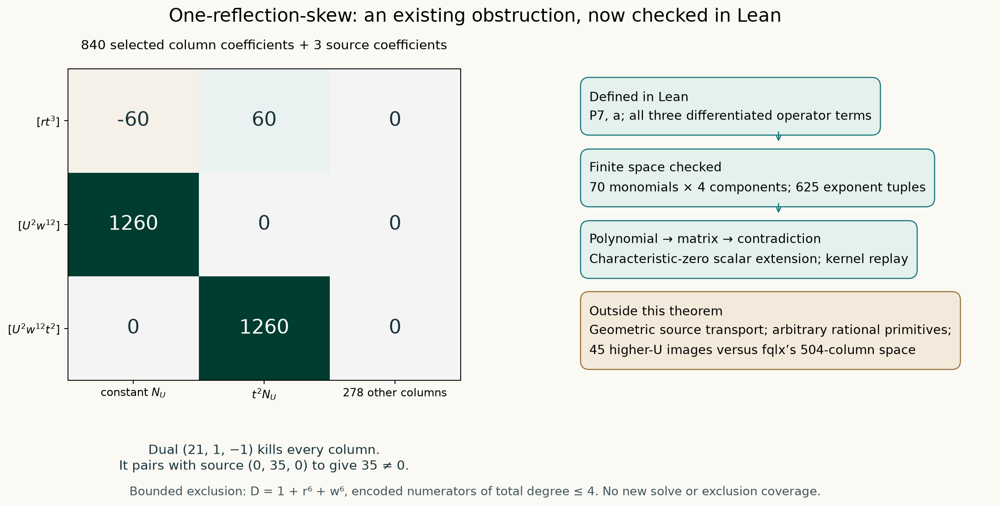

# One-reflection-skew: the three-coefficient obstruction in Lean

21 October 2026. The existing degree-four chart obstruction now has a Lean
polynomial-to-matrix proof. This strengthens its verification, without adding
a denominator exclusion or solving the target. The requested comparison of
45 higher-U operator images with fqlx's 504-column space was deferred when
the user redirected this batch to Lean; no result for that comparison is claimed.

[](../visualizations/skew-lean.svg)

The picture displays the two nonzero selected columns and groups the other
278 zero columns. It is generated from the checked Lean source and receipt;
it does not represent a full matrix rank computation or geometric existence.

## Inputs and attribution

Notebook parent: [`ba09d7f`](https://github.com/rbajaj5/hodge-lab/commit/ba09d7f31af83a5e6126a1b9fd691467e525c149).
Upstream: [`a6b4cc4`](https://github.com/hodge-computer/sextics/commit/a6b4cc49452abe31ead0be71d04e8146639896d9).
The protected `instance.rec` and `record.json` were freshly read at that pin
and matched the saved bytes. Their hashes and the reused notebook inputs are
in [inputs.json](../formal/results/skew-lean/inputs.json).

The protected order is `(X0,X1,X2,Y0,Y1,Y2)`, `q=1`, and
`A=X0^3 Y0^3`. The chart is `Y0=1`,
`(X0,X1,X2,Y1,Y2)=(x,rx,wx,t,z)`, `U=x^2`.
The quotient, residue and rank-two interpretation are prior work of
[fqlx](https://github.com/hodge-computer/sextics/discussions/127#discussioncomment-19080252).
The source reduction and the exact bounded calculation are reused from
[checkpoint 118](skew-base-derivatives.md) and the
[independent checkpoint-119 audit](skew-small-obstruction-audit.md), including
the separate ChatGPT review. Those completed calculations were not rerun.
This batch was implemented and compiled locally, with a separate read-only
review of the new definitions. No new ChatGPT calculation was requested.

## What Lean proves

In the first four variables `(U,r,w,t)`, put

$$
a=1+r^6+w^6,\quad
P7=7aU^3+7rt(1+r^2w)U^2+rt(1-t^2)U+7(1+t^6).
$$

The Lean source constructs the complete operator columns for

$$
\mathcal M(N)=60a\nabla P7\cdot N-72P7a\operatorname{div}N
                 +72P7N\cdot\nabla a,
\qquad s=35U^2a^2.
$$

It reuses the proved sparse-polynomial interpretation, rather than importing
the Python matrix or accepting its row identities as hypotheses. An unused
fifth coordinate allows reuse of that existing library without changing old
proofs; all exponents in that coordinate are zero.

The 70 listed monomials cover precisely all tuples in `{0,...,4}^4` with
sum at most four. `monomial_coverage` checks all 625 tuples. Four independent
components therefore give 280 columns. This finite coverage statement is
formalized; a separate API theorem expanding an arbitrary `MvPolynomial`
with a `totalDegree <= 4` hypothesis into this list is **not** included.

Kernel reduction establishes the 840 selected column coefficients and the
three source coefficients:

| Coefficient | Constant `N_U` | `t^2 N_U` | Each other column | Source |
| --- | ---: | ---: | ---: | ---: |
| `[rt^3]` | -60 | 60 | 0 | 0 |
| `[U^2 w^12]` | 1260 | 0 | 0 | 35 |
| `[U^2 w^12 t^2]` | 0 | 1260 | 0 | 0 |

The integer dual `(21,1,-1)` annihilates every column and pairs with the source
to give 35. The existing reusable row-certificate theorem then excludes
solutions to the encoded polynomial equation. `no_polynomial_solution`
extends this conclusion to **every characteristic-zero field**, including
complex constant coefficients, via the rational coefficient homomorphism.

[Main Lean module](../formal/HodgeLab/OneReflectionSkew/ThreeCoefficient.lean)
· [Mutation identities](../formal/HodgeLab/OneReflectionSkew/Controls.lean).

## Executed verification and reproduction

With the pinned dependencies installed, from `formal` run:

```text
python3 -O check_skew.py
```

Then, from the repository root:

```text
python3 scripts/visualize_skew_lean.py
```

The [final receipt](../formal/results/skew-lean/validation.json) records:

- Lean 4.31.0 and mathlib `fabf563a7c95a166b8d7b6efca11c8b4dc9d911f`.
- Successful compilation; all 17 declared theorem reports use only
  `propext`, `Classical.choice`, and `Quot.sound`.
- Successful default kernel replay of the two reused helper modules and
  the two new modules. This trusts imported declarations and is not a fresh
  replay of mathlib.
- Two rejected false propositions: changing the `Urt^3` source coefficient
  from -1 to +1, and claiming the middle target coefficient is 36.
  The first mutation has first selected coefficient 60 and dual pairing
  2520, both separately proved in Lean.
- 78.016 seconds for the final verification, with 120 seconds per command
  and 600 seconds for the full run. No timeout occurred.

The final run reused the compiled build and replayed the kernel again. The
preceding fresh build took 66.672 seconds. Review also tightened the negative
test: a stuck reduction is now rejected as an invalid test outcome, and an
explicit false-proposition diagnostic is required. A run starts with an
IN_PROGRESS receipt and writes FAIL on error, preventing a stale PASS.

The checker uses explicit failures even with Python assertions disabled.
It records commands, exact source and compiled-artifact hashes, logs and
negative-control source files. Earlier elaboration and WSL PATH failures
are preserved in [development](../formal/results/skew-lean/development/README.md).
The CI workflow now includes this verifier; this note reports the executed
local verification, not an unobserved future CI outcome.

## Limits and publication

The theorem does not formalize transport from the protected sextic to this
chart source, a full certificate space, the 45-versus-504 image comparison,
or a rational primitive. It cannot exclude other denominators or degrees.
The earlier degree-five counterexample to these three rows' sufficiency
remains relevant. These particular rows also fail to detect omission of the
denominator derivative; the full term is present and its polynomial formula
is proved, while the broader prior checker supplies that separate control.

The latest discussion reply was already present in checkpoint 119. The live
ledger at `ba09d7f` includes its verified outcome and tally 29; the earlier
prepublication entry is retained as history. There was no missing entry to repair.

The prepublication ledger audit accompanies this batch. The intended upstream
action is one short verification addendum to our existing
[reply 19111234](https://github.com/hodge-computer/sextics/discussions/127#discussioncomment-19111234),
after this audit is pushed. Its actual outcome will be recorded afterward.


**Publication outcome:** the prepublication audit was pushed in
[b7ec864](https://github.com/rbajaj5/hodge-lab/commit/b7ec8648acf95fb2ce86f11d3b207b702d00d76a).
The Lean addendum to [reply 19111234](https://github.com/hodge-computer/sextics/discussions/127#discussioncomment-19111234)
was then published and read back exactly, with its original content preserved.
[Verified outcome](../formal/results/skew-lean/upstream/outcome.json). The
contribution tally remains 29; no additional comment was created.


### Later formal extension — 21 October 2026

[Checkpoint 122](skew-lean-extension.md) closes the arbitrary-MvPolynomial
expansion gap stated above: the new theorem accepts all four numerator
polynomials with total degree at most four and explicitly absent fifth
coordinate. It applies the same existing obstruction and changes no search
coverage. The source transport, other denominators and 45-versus-504 comparison
remain outside the theorem. This later extension preserves the original proof,
receipt and publication history.
