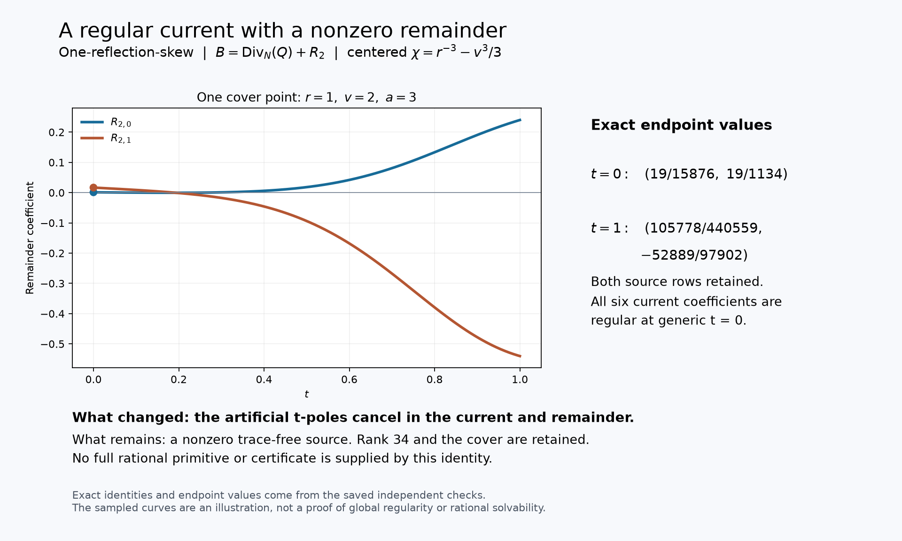

# One-reflection-skew: constructive mixed-direction current search

24 October 2026. **Bounded constructive batch complete; the target remains
open.** The local current reductions are checked. Pro's additional reported
obstruction and inverse-repair results await recovery of its failed file export.

The user redirected this batch toward the solution and benched Lean. The
unchanged target is `one-reflection-skew`, with `q=1` and
`A=X_0^3 Y_0^3`. The question is whether an explicit rational current cancels
the full physical source. Completed scalar-trace and formal results are reused;
no Lean work belongs to this batch.

## Inputs and convention

The notebook parent is `06e88a91ad159035a5b2b422d167d5ae76899772` and the
upstream head at dispatch is `27f4bb9ad8757e5841f884d9d30124a3c97a847d`.
We use the already-pinned
[benediamond packet](../results/skew-physical-source-20261023/inputs/benediamond/packet/one-reflection-skew-followup/README.md),
building on fqlx's full compact connection. Its connection JSON SHA256 is
`a86c01f7fed725aac86e958a10f484b9b340765714c5b228513890977a59ce5d`.
The [source normalization audit](skew-physical-source-normalization.md)
retains the protected-source binding and orientation comparison.

Write

\[
 f=r^{18}+r^{12}+(vr-1)^6-ar^{15},\qquad
 b=tv,\quad c=t(1-t^2)/7,\quad d=1+t^6.
\]

The source, in the packet's positive residue convention, is

\[
 B=\frac{r^{11}}{12f_r}M_b e_0\,da\wedge dv\wedge dt.
\]

Both rows use the ordered fibre basis
`(dV/nu^5, V dV/nu^5)`, with matrix columns indexing the input basis.
The operator is `nabla=d+N`, where

\[
 N_a=M_a,\qquad N_v=tM_b,\qquad
 N_t=vM_b+(1-3t^2)M_c/7+6t^5M_d.
\]

Partial derivatives in `a,v` include the implicit cover derivatives
`r_a=r^15/f_r` and `r_v=-6r(vr-1)^5/f_r`; `r_t=0`.
These are rational function-field identities on the common open where the
stated denominators are invertible. They are not claims at singular fibres.

## Candidate passed to the constructive lead

Reuse the packet's first current `X` and its exact remainder

\[
 B=\nabla X+R_0\,da\wedge dv\wedge dt,\qquad
 R_0=\frac{g}{36t^2}e_1,
\]

where `psi=r^-3`, `g=psi_vv`, and `k=v psi_v-psi`, hence `k_v=v g`.
The scalar integration identity and the current `X` are earlier work, not
new discoveries in this batch.

The additional fluxes constructed by the local algebra worker are

\[
 Y_a=0,\qquad Y_v=-\frac{k}{108at}e_0,\qquad
 Y_t=-\frac{g}{36t}e_1.
\]

With cyclic flux order `(dv wedge dt, dt wedge da, da wedge dv)`, the
remaining vector is

\[
 R_2=\frac{g}{36t}\left(N_t e_1+\frac{v}{3a}e_0\right)
       +\frac{k}{108a}M_b e_0.
\]

The checked identity is `R0=Div_N(Y)+R2`. The numerator of the first
term vanishes at `t=0`; the cancelled expression has the limit

\[
 R_2\big|_{t=0}=\begin{pmatrix}g/(10584a)\\gv/(1512a)\end{pmatrix}.
\]

At `r=1,v=2,a=3`, the cover equation holds, `f_r=-3`, `g=42`, and
`k=-13`. This gives the nonzero limiting remainder `(1/756,1/54)`.
Thus pole removal alone does not solve the source equation.

### Correction before use in the trace-free system

The uncentered identity above remains valid, but `Tr(psi)=6v^3`; it does
not automatically give a trace-free current or remainder. Replace

\[
 \psi\longmapsto\chi=r^{-3}-v^3/3,\qquad
 g\longmapsto\widehat g=g-2v,\qquad
 k\longmapsto\widehat k=k-2v^3/3.
\]

The degree is 18, so `Tr(chi)=0`. Since `chi_a=psi_a`, this preserves
the original physical source. The same identities apply with the centered
scalars. This correction keeps the full trace-free component instead of
silently adding a scalar-trace component. It is not a new scalar-trace
solvability argument. Both the raw and centered attempts are retained.

A further representative for the combined current is

\[
 Q_a=-\chi M_b e_0/36,\qquad Q_t=\chi_v M_b e_1/36,
\]
\[
 Q_v=\frac{\chi M_a e_0-\chi_vN_t e_1-
       (v\chi_v-\chi)e_0/(3a)}{36t}.
\]

Its checked direct identity is `B=Div_N(Q)+R2`, now with centered
scalars. The apparent `t` denominator in `Q_v` cancels. Removing this
artificial pole does not reduce rank 34, remove cover ramification poles,
or establish rational solvability. The original source was already regular
at `t=0`; this repairs a pole introduced by an earlier reduction. It also
introduces `a^-1`, so a simpler expression is not automatically a better
search space.

For the recommended centered version, the ordinary point
`(r,v,a,t)=(1,2,3,1)` has `Delta=1036` and the nonzero remainder

\[
 R_2=(105778/440559,-52889/97902)^T.
\]

At `t=0` on the same cover point its value is `(19/15876,19/1134)`.
Regularity here requires `a!=0`, `r!=0`, `f_r!=0`, and `Delta!=0`.
The current and remainder extend across `t=0` on that open; the claim does
not cover the other excluded divisors.



The [figure generator](../results/skew-mixed-current-20261024/render_current.py)
uses the saved exact expressions and endpoint values. Its sampled curves
illustrate the nonzero remainder; they are not an additional solvability test.

## A second route: beta current and its denominator trade

The reused Pro chat constructed a different mixed-direction current from
the packet's twisted beta identity. The local checker independently derived
its scalar operator directly from the pinned connection. This is a separate
route from the regular `Q` representative above.

Put `a=A(r,v)=r^3+r^-3+(vr-1)^6/r^15`, and write

\[
 p_8=t^8-3t^6-3t^2+1,\quad q_8=t^8-5t^6-5t^2+1,
\]
\[
 W_a=\frac{tp_8}{7(1+t^6)},\quad
 W_v=\frac{tvq_8}{21a(1+t^6)},\quad W_t=\frac{t^2(1-t^2)}{21a}.
\]

For a rational scalar `h`, the three fluxes `J_i=h W_i e1` have zero
first connection row. Their second row is

\[
 \mathcal Lh=W_aD_ah+W_vD_vh+W_t\partial_t h+
 \frac{t(1-3t^2+2t^6-4t^8)}{21a(1+t^6)}h.
\]

Here `D_a,D_v` still include cover motion. Set

\[
 E=W_a-A_vW_v,\quad H=3ap_8-vA_vq_8,\quad
 h_*=-\frac{A_v\chi_v}{36t^2E},\qquad E=\frac{tH}{21a(1+t^6)}.
\]

Then `B=Div_N(X+J)+R_beta e1`, with the centered version of the
packet's earlier `X` and

\[
 R_{\beta}=\chi_{vv}/(36t^2)-\mathcal Lh_*.
\]

The separate exact check confirms cancellation of the third- and second-order
`A_r` poles. It leaves at most first order there, but does not cancel the
source. At `(r,v,t)=(1,2,1)`, `a=3`, `h_*=7/2`, `Lh_*=1`, and
`R_beta=1/18`. Actual-cover polynomial-gcd witnesses at `v=2,t=1`
show that simple `A_r` poles and double `H` poles survive.

This candidate has a real cost: `J` has generic `t` orders `(-2,-2,-1)`;
the remainder has order `-2`, with leading coefficient `-47/6` at
`r=1,v=2`. The pole improvements of this route and the regularity of `Q`
must not be advertised as simultaneous properties of one current.

There is also a trace limitation. Multiplication by `A_v/E` depends on the
cover root. Even though `chi` is centered, this does **not** automatically
make `J` or `R_beta` trace-free. Their full compact-source identity is the
claim here. A trace-free version would require an actual trace projection;
the present beta calculation is not labeled a rank-34 reduction.

The [independent beta handoff](../results/skew-mixed-current-20261024/beta-checker/README.md)
gives the reduced scalar survivor explicitly and identifies its possible
pole support as `r,t,A_r,H`. The point and gcd witnesses diagnose this
particular candidate; they do not exclude general mixed-direction currents.

## Executed evidence and failed attempts

### Pro continuation and unavailable evidence packet

The constructive lead consumed the centered remainder and tested the beta
route above. It then reports one polynomial-inverse repair modulo `r^16 A_r`,
with a nonzero exact residual, and a complete rational `t`-only exclusion
at the fixed point `(a,v,r)=(3,2,1)` by ranks 6/7 of a 26-by-6 system.
These additional results are **Pro-reported, not locally verified**: both
the ZIP and alternate patch downloads failed, as did a single re-export
request/retry. The [handoff report](../results/skew-mixed-current-20261024/pro-report.md)
preserves the exact reported values, hashes, scope and delivery errors.
No additional mathematical claim is promoted from the missing receipts.
The first beta candidate remains independently supported by the saved local
checks above. Its exact failure does not depend on recovering Pro's packet.

### Saved local executions

These are separate exact Python/SymPy executions by AI agents, not independent
human reviews or new Lean/kernel results. The coordinator inspected the
artifacts and verified their receipt bindings; it did not rerun the mathematics.

| Execution | Evidence | Scope |
| --- | --- | --- |
| [Algebra final check 05](../results/skew-mixed-current-20261024/algebra/check-05/validation.json) | 29 exact checks, 3 rejected mutations; 15.657 seconds wall time | Generic-sheet rational Jacobian/context, current identity, centering and explicit nonzero witnesses. Earlier successful runs overlap and are not added to this count. |
| [Independent current check](../results/skew-mixed-current-20261024/checker/check-current.json) | 11 checks, 4 rejected sign controls; 1.672 seconds | Direct `Y` identity, implicit cover derivatives and raw residual regularity. |
| [Independent regular-current check](../results/skew-mixed-current-20261024/checker/check-regular-current.json) | 16 checks, 3 rejected sign controls; 6.063 seconds | Direct `Q` identity, all six components regular, reciprocal Newton sums and centered witnesses. |
| [Independent beta-current check](../results/skew-mixed-current-20261024/beta-checker/beta-check.json) | 7 checks, 1 rejected sign control; 1.359 seconds | Canonical flux, both connection rows, scalar operator and exact point survivor. |
| [Independent beta pole check](../results/skew-mixed-current-20261024/beta-checker/beta-poles.json) | 14 checks; 17.766 seconds | Exact formal-derivative identity, canceled orders, actual-cover gcd witnesses and the denominator trade. |

All symbolic processes had 60-second external limits. The algebra worker's
expanded-expression attempts [02](../results/skew-mixed-current-20261024/algebra/check-02/execution.json)
and [04](../results/skew-mixed-current-20261024/algebra/check-04/execution.json)
timed out; their distinct script snapshots and logs are preserved. Rewriting
the direct identity before physical substitution and checking the centering
polynomial without re-expanding the cover derivatives made the final bounded
run finish. The separate checker also preserves a
[prototype timeout disclosure](../results/skew-mixed-current-20261024/checker/prototype-run-notes.json).
Timeouts supply no exclusion or positive evidence.
The beta checker separately retains two 58-second watchdog attempts in its
[prototype record](../results/skew-mixed-current-20261024/beta-checker/prototype-run-notes.json).
They were replaced by exact derivative-variable algebra and univariate gcds,
not counted as passing computations.

The [algebra handoff](../results/skew-mixed-current-20261024/algebra/handoff.txt)
records the generic-sheet map calculation and explains why summing the full
form over sheets still projects away the source rather than integrates it.
This batch's solution search did not depend on promoting that observation
to a new cohomological or formal theorem.

Reproduce with the existing pinned connection JSON, using a fresh run name:

```sh
python -O results/skew-mixed-current-20261024/algebra/run_bounded.py replay \
  results/skew-physical-source-20261023/inputs/benediamond/packet/one-reflection-skew-followup/inputs/source-rank2-connection.json
python results/skew-mixed-current-20261024/checker/check_current.py --run --connection \
  results/skew-physical-source-20261023/inputs/benediamond/packet/one-reflection-skew-followup/inputs/source-rank2-connection.json
python results/skew-mixed-current-20261024/checker/check_regular_current.py --run --connection \
  results/skew-physical-source-20261023/inputs/benediamond/packet/one-reflection-skew-followup/inputs/source-rank2-connection.json
```

The algebra script uses explicit exceptions under `-O`; the independent
checker commands require normal Python assertion behavior. Replay writes
new receipts, so use a separate checkout/copy to preserve historical outputs.
Python 3.11.9 and SymPy 1.14.0 were used for these local executions.
The beta scripts and their bounded commands are in their linked README.

The coordinator's [source/receipt binding review](../results/skew-mixed-current-20261024/local-bindings.json)
matches the final scripts to their receipts. The first two author receipts
did not record snapshot hashes; their retained snapshots are not promoted
to contemporaneously hash-bound executions. A separate read-only
[scope review](../results/skew-mixed-current-20261024/scope-review.json)
caught the wording "closed beta" and corrected it to "twisted beta".
It is not another mathematical run.

## Bounded team run

The actual Goal began at 14:34:34 UTC, with a 45-minute research bound,
60-second symbolic-process bounds, 45-second network bounds and a separate
15-minute integration bound. The reused Pro chat is the constructive lead;
the local algebra worker owns explicit current formulas; a distinct checker
tests those formulas. The coordinator integrates the notebook and ledger.

The algebra worker's first scalar integration proposal was recognized as
already present in the packet and was not promoted as new progress. The
all-sheet zero-trace route was set aside: projecting the entire source to
zero loses the trace-free equation rather than constructing a primitive.
Pro visibly acknowledged and consumed the `R2` handoff, then began testing
mixed `a,v,t` fluxes against the full equation `Div_N(Z)=R2`.

The centering correction was then delivered to Pro, which explicitly
acknowledged it and updated its constructive and checking agents. The separate
local checker consumed the direct `Q` and centering handoffs and executed the
checks above. Delivery and actual downstream use are recorded separately from
solving the target. Lean remained benched.

No full compact primitive, lift with all fibre-exact corrections, global
clearing, homogeneous certificate, or accepted solve follows from the current
reduction. The next equation is still `Div_N(Z)=R2` for the centered remainder.
The beta route supplies a second explicit nonzero survivor, with a documented
denominator trade. The remaining constructive obligation is a mixed current
cancelling that survivor or the centered `R2`, with all connection terms and
introduced divisors controlled. The reported t-only exclusion would concern
only its specified fixed-point family, even after its evidence is recovered.
No further search was started. There was no upstream post, reply, edit or PR;
Posts 1–29 and tally 29 discussions / one closed maintenance PR / zero accepted
authored solves are unchanged.

Credit fqlx for the compact connection and benediamond for the physical cover
and earlier integration-by-parts current; Benjamin E. Diamond and the
hodge.computer contributors supplied the fixed problem and framework. The
new formulas and checks here are AI-assisted work for Ravi Bajaj. Separate
AI executions are not independent human review. No new Lean or CI execution
is claimed.
