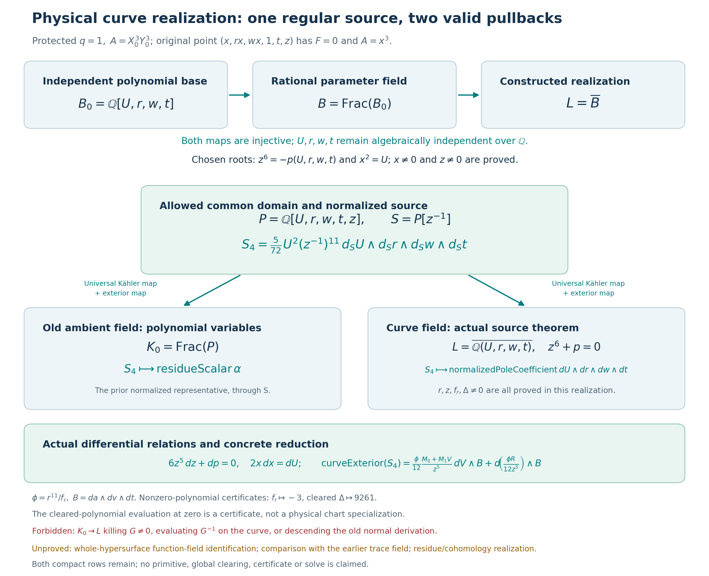

# Physical curve realization and the allowed Kähler pullback

24 October 2026, America/New_York. One bounded Pro mathematical unit, with
one Lean writer and two separate read-only AI reviewers. The existing
Goal-enabled coordinator owns publication and full remote CI; no Goal
control is exposed to this worker and no worker commit or push is made.

Exact notebook parent: `e2182223a0395cfb758a2ee09e304eb940b7a67a`.
Live upstream: `e96be434bd55d6013d7a5854732cb317ca0e43e7`.
Fresh reads match both pins. The current protected target and upstream policy
are byte-identical to the earlier saved sources. Historical receipts and
ledger text are preserved, with checkpoint 142 appended separately.

## Result and precise scope

The [new Lean module](../formal/HodgeLab/OneReflectionSkew/PhysicalCurveRealization.lean)
constructs an actual field realization with independent base coordinates,
recovers the original square-cover coordinate, and constructs compatible
universal Kähler and exterior maps from one allowed localization to both the
old ambient field and the curve realization. The same normalized regular
four-form maps to the old `residueScalar • alpha` and to the curve form used
in the preceding source-reduction theorem. That theorem is instantiated
with all its curve and nonzero hypotheses proved in this realization.

This closes the requested physical field/common-domain differential bridge.
It does not identify the chosen field with the whole irreducible hypersurface
function field or a minimal root field. It does not compare the new field
with the earlier trace splitting-field tower, or construct a residue map,
de Rham/cohomology realization, Gauss–Manin identification or primitive.

## Protected source and actual field

The current protected `data/one-reflection-skew/instance.rec` confirms
q=1, A=X0³Y0³, and the literal F already bound by `ChartSubstitution`:

\[
\begin{aligned}
F={}&X_0^6+X_1^6+X_2^6+Y_0^6+Y_1^6+Y_2^6\\
&+X_0^3X_1Y_0Y_1+X_1^3X_2Y_0Y_1
 +(X_0X_1Y_0^3Y_1-X_0X_1Y_0Y_1^3)/7.
\end{aligned}
\]

The [fresh raw record](../results/skew-physical-curve-20261024/inputs/upstream/data/one-reflection-skew/instance.rec)
has SHA256 `c6621c8845addf857ed30726f86449d5ea3310c7609641db9e326f9b85f10fbd`.
The [source manifest](../results/skew-physical-curve-20261024/source-pins.json)
binds the literal chart polynomial, transitive local imported proofs, policy,
toolchain, protected source and reused prior CI evidence. No old pin is replaced.

Define

\[
B_0=\mathbb Q[U,r,w,t],\qquad B=\operatorname{Frac}(B_0),\qquad L=\overline B.
\]

`polynomial_embedding_injective` and `base_embedding_injective` prove the
actual embeddings into L. `parameters_independent` proves algebraic
independence of the four coordinate images over Q; they are not specialized
to numerical values or collapsed when the curve relation is imposed.
All rings and fields carry explicit Q-algebra structures and compatible
scalar towers. The old ambient target uses the exact localization-induced
Q-algebra captured by its previous Kähler objects; the proof does not
silently replace it with a merely propositionally equal field Q-algebra.

The literal cubic is

\[
p(U,r,w,t)=(1+r^6+w^6)U^3+rt(1+r^2w)U^2
 +\frac{rt(1-t^2)}7U+(1+t^6).
\]

Algebraic closedness constructs z with \(z^6=-p\), rather than assuming the
existence of a curve point. The polynomial `cubic7` represents 7p in B₀;
its evaluation at four zeros is 7, so it is nonzero. Injectivity gives
p≠0 in L, and the curve equation gives z≠0.

The same field also contains a constructed x satisfying x²=U. Since U≠0,
x≠0. The actual six-variable Q-algebra map `physicalMap` evaluates at

\[
(X_0,X_1,X_2,Y_0,Y_1,Y_2)=(x,rx,wx,1,t,z).
\]

The reused protected substitution then proves F=0 and A=x³ at that point.
Thus the original square-cover coordinate is recovered; the construction
is not described solely as the reflection-quotient U-chart. No
irreducibility of either defining equation is assumed or concluded.

## Why the whole ambient fraction field is not the domain

Let P=Q[U,r,w,t,z] and let G be the literal chart polynomial z⁶+p. The
previous ambient field is K₀=Frac(P). Its existing theorem proves G≠0 there.
Any unital homomorphism from K₀ to a field is injective, so it cannot send G
to zero. `no_ambient_field_specialization` proves this obstruction directly.
In particular, G⁻¹ in the old pole expression cannot be evaluated on G=0.

The valid common domain is

\[
S=P[z^{-1}].
\]

The map `chartMap : P →ₐ[Q] L` sends the literal G to zero. Its value on z
is a proved unit, so the localization universal property constructs
`regularToCurve : S →ₐ[Q] L`. The old ambient polynomial map also sends z
to a unit and gives `regularToAmbient : S →ₐ[Q] K₀`.
`regularLift_polynomial` and `regularLift_inverse` prove their behavior on
polynomials and the adjoined inverse. Only powers of z are inverted.
`regular_relation_not_unit` proves that the image of G is not a unit of S.
The term “common localization” is used without adding an unproved
injectivity claim about every map out of S; the curve map has a kernel.

The already normalized coefficient has the common representative

\[
s=\frac5{72}U^2(z^{-1})^{11}\in S.
\]

`regularCoefficient_ambient` maps s to the prior `residueScalar`, and
`regularCoefficient_curve` maps s to the prior `normalizedPoleCoefficient`
evaluated on the constructed curve. This is an identification of a regular
normalized representative. It is not a new theorem taking a residue of the
entire ambient pole expression.

## Universal Kähler and exterior pullbacks

For a Q-algebra homomorphism f:S→T, `kaehlerPull f` is constructed from the
universal Kähler map, with the target's specified Q-algebra retained. The
public map is displayed as a Q-linear map; internally it is induced by the
corresponding S-linear universal map. Its defining formula is proved:

\[
f_\Omega(d_S h)=d_T(f(h)).
\]

`exteriorPull f` uses `ExteriorAlgebra.lift`, since every degree-one image
squares to zero. It is a multiplicative ring homomorphism obtained from
that algebra universal property, and its scalar compatibility is also
proved. The concrete curve maps send dU, dr, dw, dt and dz to their actual
Kähler differentials. The ambient map computes to the old `oneForm` objects.

Define the single regular four-form

\[
S_4=s\,d_SU\wedge d_Sr\wedge d_Sw\wedge d_St.
\]

Theorems `ambient_source` and `curve_source` identify its two images with

\[
\mathrm{residueScalar}\,\alpha
\quad\text{and}\quad
\mathrm{normalizedPoleCoefficient}\,
 d_LU\wedge d_Lr\wedge d_Lw\wedge d_Lt.
\]

This resolves the concrete ambient Q-algebra/Kähler compatibility issue
left in the preceding batch, through an allowed domain.

Applying the universal differential to the constructed equations proves

\[
6z^5\,dz+dp(U,r,w,t)=0,\qquad 2x\,dx=dU.
\]

The old normal derivation cannot descend unchanged: its coordinate actions
D(U)=D(r)=D(w)=D(t)=0, D(z)=1 contradict G=0 and z≠0.
`no_unchanged_normal_derivation` instantiates the existing obstruction in L.

## Generic chart conditions are proved here

The proof does not leave f_r and the physically substituted cubic Δ as
assumptions. The denominator identities are checked in Lean using small
cleared polynomials, without an expanded degree-18 discriminant.

For \(v=r^{-1}+rw\), \(a=(1+r^6+w^6)/r^3\), the derivative of the literal
cover polynomial with a,v fixed satisfies

\[
f_r=3r^{17}-3r^{11}-9r^{11}w^6+6r^9w^5.
\]

Its representing polynomial has value −3 at r=w=1. This proves the
polynomial is nonzero; the injective generic base map then proves f_r≠0 in L.

For the Δ denominator, put

\[
A_0=1+r^6+w^6,\ B_0'=t(1+r^2w),\ C_0=t(1-t^2),\ D_0=1+t^6.
\]

The proved cleared identity is

\[
\begin{aligned}
343r^6\Delta={}&9261A_0^2D_0^2-882A_0B_0'C_0D_0r^2
 +4A_0C_0^3r^3\\
&+1372(B_0')^3D_0r^3-7(B_0')^2C_0^2r^4.
\end{aligned}
\]

The right-hand polynomial evaluates to 9261 when its variables are zero.
That evaluation is solely a nonzero-polynomial certificate. It is **not** a
physical chart specialization at r=0 and not an evaluation of the whole
rational-function field. Injectivity and the separately proved generic
r≠0 justify the field statement Δ≠0. None of these generic results asserts
nonvanishing at every specialization; prior singular-specialization
receipts remain unchanged and are not rerun.

## Concrete source-reduction instantiation

With V=rU, b=tv, c=t(1−t²)/7, d₀=1+t⁶, set
B=da∧dv∧dt and φ=r¹¹/f_r. `realized_source_reduction` proves

\[
\operatorname{curveExterior}(S_4)
=\frac{\phi}{12}\frac{M_0+M_1V}{z^5}\,dV\wedge B
 +d\!\left(\frac{\phi R(V)}{12z^5}\right)\wedge B.
\]

The prior literal b-column and correction are imported unchanged. All
curve and nonzero hypotheses of `source_four_form_reduction` are discharged
in the constructed field. The fibre-first orientation and the packet's
separate global sign convention remain as documented in the preceding unit.
Both compact rows occupy covering slot 11; the reported rank-34 system is
17 covering slots times two rows, distinct from the other scalar rank-17
formulation. No old column reduction, transport or trace checker is rerun.

The existing scalar-only trace theorem belongs to its prior
Q(v)(t)(a)/splitting-field construction. This unit does not yet construct a
comparison from that field tower into L, or prove algebraic independence of
(aChart r w, vChart r w,t). It therefore does not claim that the entire
previous quotient/trace apparatus has been transported into this realization.

## Verification, limits and reproduction

The declared limit is 45 minutes, at most two implementation approaches,
120 seconds per Lean process, 600 per focused checker and 45 per network
operation. This uses one mathematical construction. Each failed source,
stdout/stderr, exit and timing is retained under
[lean-development](../results/skew-physical-curve-20261024/lean-development).
The previous scratch/toolchain cache had expired; restoration of pinned
imports is recorded as dependency restoration, not a rerun of old focused
mathematics. A sandbox network connection failure and archive ownership
warnings are retained; the restored Lean version and cache were verified.

The new focused checker explicitly enumerates all 81 declarations, including
the local ambient Q-algebra instance, audits allowed axioms, replays only the
new module and runs concrete positive and intended-failure controls. It
fails closed under Python `-O`, hashes all source inputs, and writes to fresh
directories through the repaired receipt lifecycle.

```bash
cd formal
timeout 600 python3 -O check_skew_physical_curve.py \
  --output-dir results/runs/physical-curve-reproduction
```

Use a new output directory. The pinned Lean is 4.31.0, commit
68218e876d2a38b1985b8590fff244a83c321783; Mathlib is
fabf563a7c95a166b8d7b6efca11c8b4dc9d911f. Final receipt and review details are
linked in checkpoint 142. The two separate reviewers execute no Lean or
symbolic mathematics; their source/API/evidence reviews are not independent
human review. Prior full CI40051515847 is reused evidence of the preceding
unit, not a new remote CI result.

No whole-hypersurface function-field identification, trace-tower comparison,
general residue map, de Rham/cohomology connection, primitive, global
clearing, certificate or solve is asserted. The smallest remaining bridge
toward the trace-compatible source is an explicit comparison of the new
(aChart,vChart,t) base with the prior Q(v)(t)(a) tower; a cohomology source-class
identification remains separate. Credit the protected sextics sources,
benediamond/Benjamin Diamond's cover, fqlx/Ben Burns' connection data, and
Mathlib contributors for the formal APIs.

## Final execution and visualization

The final checker-02 passed 81 declaration audits, one new-module kernel
replay, 25 positive controls and eight intended False-goal controls in
31.691 seconds. Its SHA256 is
`6c719e214997ec6ca1293d3a613698564e2bacc26cd4bc27bb41f8b811a95bea`.
All five development snapshots and both checker passes are retained.
See checkpoint 142 for failed attempts and separately attributed reviews.



Reproduce the figure from the repository root, using a new output directory:

```bash
python3 scripts/visualize_skew_physical_curve.py \
  --receipt results/skew-physical-curve-20261024/lean-development/checker-02/validation.json \
  --output-dir results/skew-physical-curve-20261024/visualization-reproduction
```

The final figure's manifest records source, receipt, generator and output
hashes; the PNG was visually inspected. The first render remains saved.


## Coordinator review and exact remaining form boundary

The Goal-enabled coordinator reused the existing Pro chat, independently
verified all 263 manifested archive members and 259 payload files, and
applied the patch to the exact parent. The intermediate staged tree was
`49de35312e9725be44911b3f0e61e81abd5c45ac`, before these review additions.
See the [application receipt](../results/skew-physical-curve-20261024/coordinator-review/patch-application.json)
and [separate source/evidence reviews](../results/skew-physical-curve-20261024/coordinator-review/independent-review.json).
The latter verified 9 sources/snapshots, 30 pinned inputs (28 matching the
parent Git bytes), 42 command streams, and the reported 81/25/8 coverage.
These AI reviews did not execute Lean; they are distinct from Pro's replay
and from the subsequent remote CI. The coordinator inspected the final PNG.

**Additional explicit limit:** nonvanishing of `oldFourForm`, `newFourForm`
or `curveExterior regularSource` is not separately formalized in this unit.
The field model and its four parameters are nonvacuous, and the coefficient
is proved nonzero. The further differential-basis/nonvanishing argument
using separable algebraic base change is still absent. This does not
invalidate the proved equality or the constructed maps.

The coordinator independently ran a small exact SymPy witness check under
Python `-O`, with eight explicit requirements: at (U,r,w,t)=(0,1,1,0),
(a,v,p,f_r,Delta)=(3,2,1,-3,243), and the chart Jacobian is -3.
The literal physical polynomial was differentiated independently; the
expanded f_r and polynomial nature of r^6 Delta were checked. These are
polynomial/rational checks, not a Lean replay or an evaluation map from the
entire fraction field. The [final receipt](../results/skew-physical-curve-20261024/coordinator-review/generic-open-point-final.json)
and [execution record](../results/skew-physical-curve-20261024/coordinator-review/generic-open-final-execution.json)
record Python 3.11.9, SymPy 1.14.0 and the 60-second external bound. The
original diagnostic and its script are preserved; the final revision adds
fresh-output enforcement. Their counts are not combined.

From the repository root, with a fresh output path:

```bash
timeout 60 python3 -O results/skew-physical-curve-20261024/coordinator-review/check_generic_open_point.py --output /tmp/physical-curve-open-point.json
```

All 4,118 prior proof/result/policy files and the 430,885-byte parent ledger
prefix were verified unchanged. Four trailing-whitespace lines in a saved
failed-attempt log are retained verbatim; staged source and documentation
pass whitespace checks. No upstream action occurred. Posts 1–29 and the
29/1/0 tally remain unchanged. Remote CI will be recorded separately.
