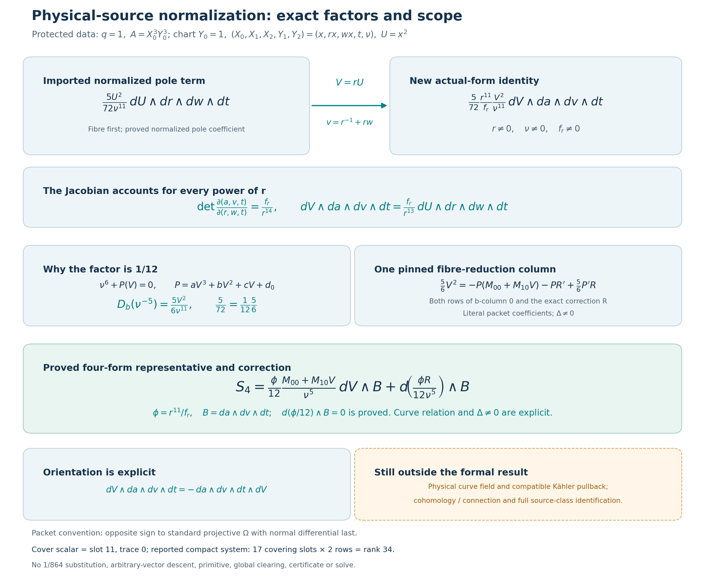

# Physical-source normalization: chart, orientation and one fibre column

23 October 2026, America/New_York. This is one bounded Pro mathematical unit
for the Goal-enabled coordinator. Parent Hodge Lab commit:
`bbb8aa406cd2a8b5ddb06d6e14358781b9c215e9`; upstream:
`b790130d43b49ec0ddc6865d0bdc949eeeee2319`. Live fetches matched both pins.
Pro supplied the mathematical handoff without publishing. The actual
Goal-enabled Codex coordinator owns integration, normal notebook publication
and full remote CI, and reused the same existing Pro chat.

The substantive result is a conditional equality of actual Kähler four-forms:
the existing normalized pole coefficient transforms to the packet's selected
b-column, with factor r¹¹/(12 f_r), plus a proved differential correction.
The proof derives the coordinate powers, the factor 1/12, the orientation
sign and the required fibre-direction constancy of the cover factor. It also
identifies that scalar with a trace-zero element of the actual degree-18
quotient. Construction of the physical curve field, its compatible Kähler
pullback and the full cohomology/connection realization remain separate.

The [Lean module](../formal/HodgeLab/OneReflectionSkew/PhysicalSourceNormalization.lean),
[focused checks](../results/skew-physical-source-20261023/lean-development),
and [separate mathematical/API account](../results/skew-physical-source-20261023/math-review)
record the precise delivered theorem inventory and execution scope.

## Protected source and notation

The current authoritative `data/one-reflection-skew/instance.rec` has
\(q=1\), \(A=X_0^3Y_0^3\), and

\[
\begin{aligned}
F={}&X_0^6+X_1^6+X_2^6+Y_0^6+Y_1^6+Y_2^6\\
&+X_0^3X_1Y_0Y_1+X_1^3X_2Y_0Y_1
+\frac{X_0X_1Y_0^3Y_1-X_0X_1Y_0Y_1^3}{7}.
\end{aligned}
\]

The [saved current record](../results/skew-physical-source-20261023/inputs/upstream/data/one-reflection-skew/instance.rec)
has raw SHA256 `c6621c8845addf857ed30726f86449d5ea3310c7609641db9e326f9b85f10fbd`.
Its literal id/F/A/q agree with the packet's older, larger metadata record.
Their file hashes are different and neither historical hash is replaced.
The existing protected substitution and normal-pole proofs are reused.

The actual [benediamond packet](https://github.com/user-attachments/files/33835156/one-reflection-skew-followup-2026-10-22.zip)
was fetched and retained: 30,606 bytes, SHA256
`e83047c7e390acca70cdb1e6525685b1d5af2477f1d0ac52a40e1165e5908e0b`.
The [packet README](../results/skew-physical-source-20261023/inputs/benediamond/packet/one-reflection-skew-followup/README.md)
and [connection input](../results/skew-physical-source-20261023/inputs/benediamond/packet/one-reflection-skew-followup/inputs/source-rank2-connection.json)
are inspected source records, not new execution receipts. Only the selected
source column and coordinate identities are checked in this unit; none of
the packet's unrelated exclusions or current searches is replayed.

| Symbol | Meaning in this unit |
| --- | --- |
| q | Protected pole order, equal to 1 |
| \(\nu\), or `z` in Lean | Fibre sixth-root coordinate, satisfying \(\nu^6=-P\) when the curve relation is imposed |
| v | New base coordinate \(r^{-1}+rw\); distinct from the input JSON's use of `v` for the sixth root |
| \(d_0\) | Constant coefficient of the cubic, \(1+t^6\) after physical substitution; called `d` in the packet |
| \(a\) | Cubic/cover parameter; the degree-18 polynomial f is monic with leading coefficient 1 |
| \(M_0,M_1\) | Rows 0 and 1 of input column 0 of \(M_b\), not two different input columns |

The source JSON says that columns index input basis and the connection
convention is \(\nabla=d+M\). Its fibre basis is
\((dV/\nu^5,V\,dV/\nu^5)\). The packet's simpler rational base has a reported
rank-34 system: 17 covering slots times two compact rows. Both compact rows
occupy covering slot 11. The earlier scalar rank-17 formulation and its
1/864 normalization use a different algebraic CM base; that factor is not
used in this derivation.

## Coordinate changes and actual forms

On the chart \(Y_0=1\), write

\[
(X_0,X_1,X_2,Y_1,Y_2)=(x,rx,wx,t,\nu),\qquad U=x^2.
\]

The prior Lean substitution identifies the protected F with
\(\nu^6+a_0U^3+b_0U^2+c_0U+d_0\), where

\[
a_0=1+r^6+w^6,\quad b_0=rt(1+r^2w),\quad
c_0=rt(1-t^2)/7,\quad d_0=1+t^6.
\]

Set

\[
V=rU,\quad v=r^{-1}+rw,\quad a=\frac{1+r^6+w^6}{r^3}.
\]

For \(r\ne0\), the new proof derives

\[
w=\frac{vr-1}{r^2},\qquad
a=r^3+r^{-3}+\frac{(vr-1)^6}{r^{15}},
\]

and the exact cubic change

\[
a_0(V/r)^3+b_0(V/r)^2+c_0(V/r)+d_0
=aV^3+tvV^2+\frac{t(1-t^2)}7V+(1+t^6).
\]

It also proves that r satisfies the existing literal degree-18 equation
\(f=r^{18}+r^{12}+(vr-1)^6-ar^{15}=0\). Here \(f_r\) means the polynomial
partial derivative holding a and v fixed, evaluated at r; it is not the
total derivative of the identically zero pulled-back equation.

Work in a characteristic-zero field H with a specified \(\mathbb Q\)-algebra
structure. The new differential is the actual universal Kähler differential
followed by the exterior-algebra inclusion. Thus products below are actual
exterior products in \(\bigwedge_H\Omega^1_{H/\mathbb Q}\).

Direct differentiation and alternating multiplication prove

\[
da\wedge dv=\frac{f_r}{r^{14}}\,dr\wedge dw,
\]

\[
dV\wedge dr\wedge dw\wedge dt
=r\,dU\wedge dr\wedge dw\wedge dt.
\]

The term \(U\,dr\) in \(dV=r\,dU+U\,dr\) vanishes by the repeated wedge.
Combining the identities gives the full four-coordinate Jacobian

\[
\boxed{dV\wedge da\wedge dv\wedge dt
=\frac{f_r}{r^{13}}\,dU\wedge dr\wedge dw\wedge dt.}
\]

The theorem `normalized_source_form_transport` starts from the previously
defined `normalizedPoleCoefficient`, using its proved value
\(5U^2/(72\nu^{11})\). Under \(r\nu f_r\ne0\), it derives

\[
\boxed{
\frac{5U^2}{72\nu^{11}}\,dU\wedge dr\wedge dw\wedge dt
=\frac5{72}\frac{r^{11}}{f_r}\frac{V^2}{\nu^{11}}
\,dV\wedge da\wedge dv\wedge dt.
}
\]

The right side is not adopted as a definition of the physical source.
The coefficient, transformed cubic, Jacobian and wedge equality are proved
from the existing normalization and actual coordinate expressions.

## Orientation and the packet sign

The new exterior-algebra proof explicitly establishes

\[
dV\wedge da\wedge dv\wedge dt
=-\,da\wedge dv\wedge dt\wedge dV.
\]

Therefore the same four-form has a positive displayed coefficient with the
fibre first and a negative coefficient with the fibre after the three base
differentials. The packet separately declares a global residue convention
opposite to standard projective \(\Omega\), in the variable order
\((X_0,X_1,X_2,Y_0,Y_1,Y_2)\), with normal differential last. Its displayed
compact source uses the positive sign; the packet's comparison assigns the
negative sign to the standard normal-last convention.

These are distinct statements: the three-swap equality is proved in Lean,
while the packet's convention is recorded from its actual README and audit
source. No unspecified reordering, global sign, or change from 5/72 to
1/864 is absorbed into a definition.

## The factor 1/12 and the literal b-column

Let \(P(V)=aV^3+bV^2+cV+d_0\). For a \(\mathbb Q\)-derivation \(D_b\)
with \(D_b b=1\) and \(D_b a=D_b c=D_b d_0=D_b V=0\), assume
\(\nu^6+P(V)=0\) and \(\nu\ne0\). Differentiating that relation derives
the value of \(D_b\nu\), rather than assuming it. The new theorem proves

\[
D_b(\nu^{-5})=\frac{5V^2}{6\nu^{11}},\qquad
\frac{5V^2}{72\nu^{11}}=\frac1{12}D_b(\nu^{-5}).
\]

This is a conditional derivation theorem with coordinate actions and the
curve equation as hypotheses. It does not construct a concrete parameter
derivation or a Gauss–Manin connection.

The packet's selected column has

\[
\begin{aligned}
\Delta&=27a^2d_0^2-18abcd_0+4ac^3+4b^3d_0-b^2c^2,\\
N_0&=27acd_0-12b^2d_0+bc^2,\\
N_1&=a(3bd_0-c^2),\\
N_R&=2N_1V^2+(3acd_0+2b^2d_0-bc^2)V+(9ad_0^2-bcd_0).
\end{aligned}
\]

With \(M_0=N_0/(6\Delta)\), \(M_1=N_1/\Delta\), and
\(R=N_R/\Delta\), the new proof establishes the cleared polynomial identity

\[
5\Delta V^2=-P(N_0+6N_1V)-6P N_R'+5P'N_R.
\]

For \(\Delta\ne0\), this gives the literal single-column reduction

\[
\frac56V^2=-P(M_0+M_1V)-PR'+\frac56P'R.
\]

The exact correction R is essential. It is not discarded, and the matrix
column is not substituted by its transpose. The corresponding relative
derivation identity uses a fibre derivation fixing a,b,c,\(d_0\), sending
V to 1, and preserving the curve relation. Such coordinate conditions are
kept explicit; the proof is not an assumption that the desired compact
source identity already holds. This selected column requires
\(\Delta\ne0\); the full packet connection can have additional denominators.

## Proved four-form representative and differential correction

The theorem `source_four_form_reduction` combines the preceding results.
Write \(B=da\wedge dv\wedge dt\), \(\phi=r^{11}/f_r\), and substitute
\(b=tv\), \(c=t(1-t^2)/7\), \(d_0=1+t^6\) into the literal column and R.
For a characteristic-zero field H with its specified Q-algebra structure,
the hypotheses are \(r\ne0\), \(\nu\ne0\), \(f_r\ne0\),
\(\Delta(a,tv,t(1-t^2)/7,1+t^6)\ne0\), and
\(\nu^6+\operatorname{cubic}(U,r,w,t)=0\). The result is

\[
\boxed{
S_4=\frac{\phi}{12}\frac{M_0+M_1V}{\nu^5}\,dV\wedge B
     +d\!\left(\frac{\phi R(V)}{12\nu^5}\right)\wedge B,
}
\]

where \(S_4\) is the previously established `normalizedPoleCoefficient`
times \(dU\wedge dr\wedge dw\wedge dt\), and \(V=rU\).
Both rows of the packet column appear in the representative.

The proof constructs the actual module-valued derivation
\(W(h)=dh\wedge B\). Alternation proves \(W(a)=W(v)=W(t)=W(r)=0\),
and `baseWedge_factor` derives \(W(\phi/12)=0\). The proof also derives
the curve differential relation and the R-derivative identity. Thus moving
the full cover factor inside the displayed correction is justified; fibre
constancy is not a missing hypothesis or an informal cancellation.

The correction is literally \(d(H)\wedge B\), for
\(H=\phi R(V)/(12\nu^5)\). This unit does not construct an exterior
derivative on arbitrary three-forms or a quotient by exact forms, so it
does not identify a de Rham class by declaring that correction exact.
H is a selected fibre-reduction correction, not a primitive of the whole
physical source. Nonvanishing of the physically substituted \(\Delta\)
remains an explicit hypothesis; generic separability of f does not prove it.

## Relation to the completed quotient and remaining boundary

The completed generic base remains \(K=\mathbb Q(v)(t)(a)\), with
\(E=K[X]/(f)\), its specified splitting field L and all eighteen roots.
The earlier scalar-extension proof constructs
\(w_{11}=\theta^{11}f'(\theta)^{-1}\in E\). Its evaluation at root
\(\rho_j\) is \(\rho_j^{11}/f'(\rho_j)\), and its trace is zero.
The new unit proves that
\(w_j=(\kappa(v)\rho_j-1)/\rho_j^2\) recovers the exact chart values
\(v=\kappa(v)\), \(a=\kappa(a)\), and that its chart-defined f_r equals
the mapped derivative at \(\rho_j\). The already proved generic distinctness
supplies nonzero f_r at these roots. Consequently the new quotient element

\[
\mathrm{sourceScalar}=\tfrac1{12}\,w_{11}\in E
\]

satisfies
\(\sigma_j(\mathrm{sourceScalar})=\rho_j^{11}/(12f_r(\rho_j))\)
and \(\operatorname{Tr}_{E/K}(\mathrm{sourceScalar})=0\).
This identifies the actual cover scalar; it does not equate that scalar
alone with the two-row compact source or discard either compact component.

The general form and derivation statements specify their field and nonzero
hypotheses. The original physical ratio chart also requires \(X_0\ne0\).
No condition \(t\ne0\) is needed for this direct \(Y_0=1\) change.
Generic simple roots do not imply every specialization is simple; the
historical \(a=2,v=1\) repeated-root control remains unchanged.

No general residue operator, de Rham complex, relative cohomology basis,
or full Gauss–Manin realization is constructed here. A coefficient identity,
an actual exterior-form identity and an identification in cohomology are
different claims. The precise remaining source-class bridge is recorded
alongside the final theorem inventory and reviewer report. No rational
primitive, denominator search, global clearing, `HasCertificate` or solve
is asserted.

The bounded attempt to specialize directly to the older concrete
`DifferentialForms.residueScalar` and `alpha` objects encountered incompatible
inferred Q-algebra/Kähler instances. Those failed sources and compiler logs
are retained; that optional concrete wrapper is absent from the delivered
module. The generic theorem using the established `normalizedPoleCoefficient`
and actual new Kähler forms is proved. The smallest substantive next link
is a compatible physical curve-field realization and Kähler pullback on the
stated chart, followed by the explicitly scoped cohomology/connection
identification. No such construction is claimed by the scalar trace result.

## Reproducible visualization

[](../results/skew-physical-source-20261023/visualization-02/physical-source-normalization.svg)

The figure encodes the proved equations, source convention and remaining
physical-field/cohomology boundary. It is not additional proof evidence.
Its [manifest](../results/skew-physical-source-20261023/visualization-02/visualization.json)
records the generator, Lean source, passing receipt and output hashes;
the PNG was visually inspected. An initial Mathtext fraction-syntax failure
is preserved with its generator and stdout/stderr.

```bash
python3 scripts/visualize_skew_physical_source.py \
  --receipt results/skew-physical-source-20261023/lean-development/checker-03/validation.json \
  --output-dir results/skew-physical-source-20261023/visualization-reproduction
```

The reproduction directory must not already exist. The visualization uses
checker-03's passing proof-source receipt; the final checker-only portability
fix does not alter that frozen mathematical source.

## Evidence and reproduction

The sole Lean writer records every attempt with exact source snapshots,
stdout/stderr, exits, UTC times and limits in the
[development directory](../results/skew-physical-source-20261023/lean-development).
The [final focused receipt](../results/skew-physical-source-20261023/lean-development/checker-04/validation.json)
passed in 27.632 seconds: **68 declaration/instance audits, one new-module
kernel replay, 19 positive controls and seven intended mathematical failures**.
It also executed eleven literal packet-to-Lean definition bindings and three
binding mutations. These are the sole Lean writer's executions, separately
attributed from the mathematical reviewer's checks. The seven false goals
reject missing r/f_r/Δ hypotheses, a reversed orientation coefficient, the
wrong 1/12 scalar, a dropped correction and a claimed scalar trace of one.
The final receipt SHA256 is
`34cae28bd59e3f86e28b74cac7e46806e10710f327852945b179489201fb0e5b`.

Only new declarations and new modules are audited and kernel-replayed;
prior proofs and receipts are imported unchanged. All public declarations,
including named instances when present, are covered. Allowed axioms are
`propext`, `Classical.choice` and `Quot.sound`.

The separate mathematical AI specialist executed a source-bound exact
check of ten identities and five mutations in 0.266 seconds of calculation
(1.725 seconds for the process), using SymPy 1.14.0 and Python 3.12.14.
It includes the combined four-coordinate
Jacobian, scalar transport and only the selected b-column. It detects
sign, r-exponent, 1/864, transposed-column and dropped-correction mutations.
An initial missing-SymPy failure and the one bounded isolated installation
are preserved. This specialist executes no Lean.

The same specialist separately checked eleven literal Lean definition bodies
against the packet-bound formulas, with three sign/scalar/column mutations,
in 0.035 seconds. That execution reuses the exact-check receipt and performs
no new symbolic calculation. Its final review is bound to module SHA256
`3a45008d92508ffd0796311fd3d9380a132fc739534a57fe187afb8f174e8288`.

The adversarial AI reviewer inspects source conventions, exact literal
bindings, theorem hypotheses and saved receipts. These roles are separate
AI reviews, not independent human review. The coordinator-relayed
nine-check/six-mutation execution is retained as
[reported support](../results/skew-physical-source-20261023/coordinator-support-reported.json)
and is not combined with this worker's executed counts.

With Lean 4.31.0 and the pinned Mathlib cache available:

```bash
cd formal
timeout 600 python3 -O check_skew_physical_source_normalization.py
```

The checker allocates a fresh output directory; an explicit directory can be
supplied with `--output-dir results/runs/physical-source-reproduction`.
Retained failures include the bounded concrete Kähler-instance attempts,
ordinary elaboration attempts, the first focused positive-control parser
error, and the first figure's fraction syntax. Passing checker-02 was followed
by checker-03 to add the literal-source gate, then checker-04 for a concrete
Windows path-separator correction. A reviewer correctly rejected the stale
checker-03 hash while that fix was being applied; its failed audit is retained.
No mathematical module change followed the frozen attempt-14 source.
The checker allocates a fresh output directory. It fails closed under `-O`,
checks immutable inputs and rejects unintended errors in negative controls.
The packet's own assertion-based scripts are not invoked under `-O` or
counted as new successful runs. The new workflow step uploads fresh outputs
through the repaired receipt lifecycle.

The prior [full Lean CI run 40046576101](https://github.com/rbajaj5/hodge-lab/actions/runs/40046576101)
is confirmed successful on `9cf1e71289b8945a0766dcf8066979b30f2a84af` by a fresh
metadata read. That validates the preceding scalar-extension batch. No new
remote CI result is claimed here, and the separate CPU workflow is not a
prerequisite for this mathematics.

The bounds are 45 minutes of mathematics/Lean, at most two approaches,
120 seconds per Lean process, 600 per focused checker and 45 per network
operation; packaging then has five minutes. All failed and interrupted
attempts remain evidence of attempts, never mathematical results.
The final changed-file handoff preserves the complete 418,118-byte parent
ledger prefix and all historical results. Posts 1–29 and tally 29/1/0 remain
unchanged. Credit benediamond / Benjamin Diamond for the simpler cover and
packet, fqlx / Ben Burns for the compact source/connection data, and Mathlib
contributors for the formal APIs.


## Coordinator integration and separately executed checks

The coordinator verified the archive SHA256, all 358 manifested members and
353 payload paths. Applying the patch to the exact parent produced tree
`308ddff1b5cec7490b51017cedbbb7b150967a35`. The
[application receipt](../results/skew-physical-source-20261023/coordinator-review/patch-application.json)
records this intermediate tree, before coordinator evidence additions.
A Windows path-length error in the first extraction was resolved by using
a fresh shorter destination; the partial extraction was preserved. This
was a packaging operation, not a mathematical failure.

The coordinator independently executed the saved
[rational-expression checker](../results/skew-physical-source-20261023/coordinator-review/check_source_normalization.py)
under Python `-O`: **nine recorded checks and six deliberate mutations**
passed in **0.328 seconds**, with a 60-second external bound, Python 3.11.9
and SymPy 1.14.0. The checks read both entries of the selected b-column and
its correction from the pinned JSON, reconstruct the coordinate Jacobian,
and check the coefficient, power and orientation factors. One of the nine
records is the orientation sign; these are not nine distinct Lean theorems.
The [receipt](../results/skew-physical-source-20261023/coordinator-review/normalization-check.json)
and [execution record](../results/skew-physical-source-20261023/coordinator-review/normalization-execution.json)
are separate from all Pro counts and supersede their status as merely
coordinator-reported support. No full packet replay was performed.

From the repository root, using a fresh output path:

```bash
timeout 60 python -O results/skew-physical-source-20261023/coordinator-review/check_source_normalization.py --connection results/skew-physical-source-20261023/inputs/benediamond/packet/one-reflection-skew-followup/inputs/source-rank2-connection.json --output /tmp/source-normalization-check.json
```

A separate [source-field comparison](../results/skew-physical-source-20261023/coordinator-review/packet-target-check.json)
verifies exact whitespace-normalized equality of id, q, F and A between
the packet and current protected record, despite differing raw file hashes.
It is a source-binding check, not another mathematical replay.
The coordinator also inspected the final rendered figure. Full remote
Lean CI is pending the proof commit and will be recorded separately.
No upstream publication or change to Posts 1–29 or the 29/1/0 tally.


The final [independent coordinator-side AI review](../results/skew-physical-source-20261023/coordinator-review/independent-final-review.json)
found no blocking proof or receipt defect. It checked nine current source
files and snapshots, 44 pinned inputs, 25 parent Git bindings, 39 command
streams, all 68 declarations, the 19 positive examples and seven intended
False-goal failures. It executed no Lean or symbolic replay. It confirmed
that the actual wedge derivation and factor constancy are proved, and that
the physical-field, discriminant and cohomology boundaries remain explicit.
