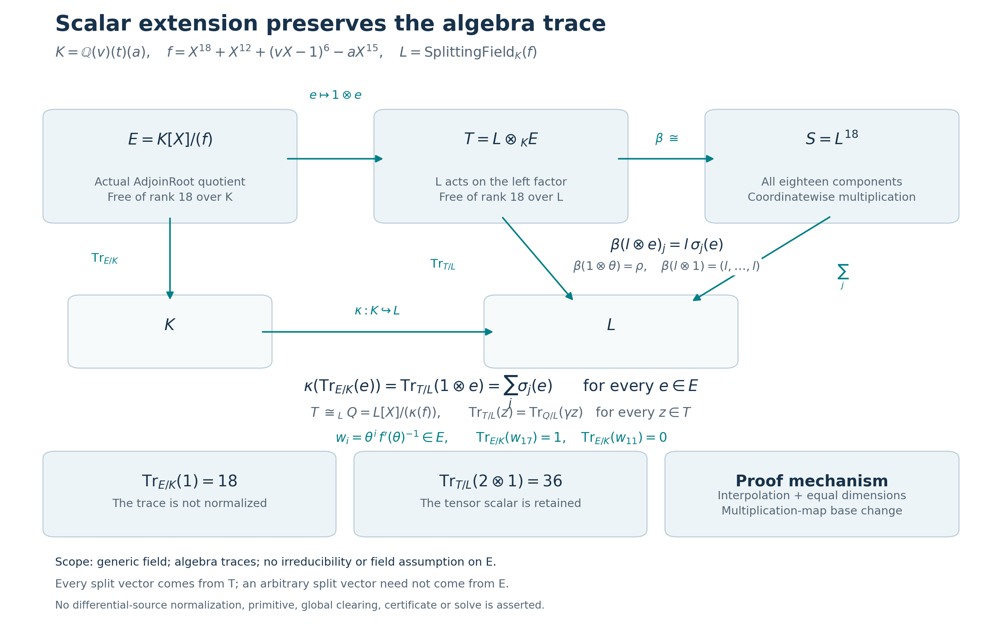

# Trace-compatible scalar extension for the physical cover

23 October 2026, America/New_York. **A Goal-enabled Codex coordinator reused
the existing Pro chat for mathematics, and owns integration, publication
and full remote CI.** This bounded unit starts from
Hodge Lab `716174af1c83b45e4a7c3db8f97a11eb0a3126bb` and upstream
`b790130d43b49ec0ddc6865d0bdc949eeeee2319`; both live fetches matched those pins.
Goal controls remain in the coordinator; Pro supplied the bounded mathematical handoff.

The new [Lean module](../formal/HodgeLab/OneReflectionSkew/ScalarExtensionTrace.lean)
constructs the actual scalar-extension isomorphism from the physical polynomial
quotient to the existing split algebra and quotient. It proves trace compatibility
for arbitrary elements, then transports the explicit derivative-weighted elements
back to the original quotient. Slot 17 has trace 1 and slot 11 has trace 0 there.
No irreducibility or field structure on that quotient is assumed.



## Exact objects and canonical maps

Retain the preceding unit's explicit iterated rational-function field

\[
K=\mathbb Q(v)(t)(a),\qquad
f=X^{18}+X^{12}+(vX-1)^6-aX^{15},\qquad
L=\operatorname{SplittingField}_K(f).
\]

The successive parameters are transcendental over the preceding fields;
all fields have characteristic zero. The canonical map
\(\kappa:K\hookrightarrow L\) is `GenericDistinctRoots.baseToSplit`, whose
injectivity was already proved. The existing `roots : Fin 18 → L` enumerates
all eighteen distinct roots in the full splitting field. The generic-root
construction, literal source binding and split-basis mathematics are imported
from the published parent, without rerunning their focused checkers.

| New Lean object | Mathematical meaning |
| --- | --- |
| `E` | `AdjoinRoot genericPolynomial`, the actual commutative algebra \(K[X]/(f)\) |
| `theta` | The class \(\theta=[X]\in E\) |
| `T` | \(L\otimes_K E\), with its standard **left** \(L\)-algebra structure |
| `iota` | The canonical \(K\)-algebra map \(e\mapsto1\otimes e\) |
| `Q` | The existing `CoverAlgebra 1 roots`, namely \(L[X]/(\prod_j(X-\rho_j))\) |
| `sigma j` | The evaluation \(K\)-algebra homomorphism \(E\to L\), \(\theta\mapsto\rho_j\) |
| `beta` | An actual \(L\)-algebra isomorphism \(T\simeq_L L^{18}\) |
| `quotientComparison` | An actual \(L\)-algebra isomorphism \(T\simeq_L Q\) |

The names `iota` and \(\kappa\) distinguish the quotient-to-tensor map from
the coefficient-field embedding. Each `sigma j` is an evaluation homomorphism;
it is not asserted to be injective. The algebra \(E\) need not be a field or
a domain. The explicit theorem `mapped_polynomial_eq` identifies
\(\kappa(f)=\prod_j(X-\rho_j)\), using the unchanged literal polynomial.

Monicity supplies `finiteE` and `freeE`. The quotient's power basis and its
base-changed tensor basis prove `finrankE = 18` and `finrankT = 18`;
`finiteT` and `freeT` are explicit instances. No dimension of \(L/K\) enters
these statements. The tensor orientation and the field of each trace are
fixed in the declaration types.

## Why the comparison is an isomorphism

The tensor universal property gives the forward homomorphism with formula

\[
\beta(l\otimes e)_j=l\,\sigma_j(e).
\]

In particular, `beta_theta` and `beta_scalar` prove

\[
\beta(1\otimes\theta)=(\rho_j)_j,\qquad
\beta(l\otimes1)=(l,\ldots,l).
\]

For any vector \(y\in L^{18}\), interpolate an \(L\)-polynomial with values
\(y_j\) at the distinct roots. Evaluating it at \(1\otimes\theta\) gives a
preimage under \(\beta\). Thus the map is surjective. Both sides have
dimension 18 over \(L\), so the map is also injective. `AlgEquiv.ofBijective`
packages this proof as an actual algebra isomorphism.

Composing with the inverse of the previously proved split-quotient evaluation
isomorphism gives `quotientComparison`. It sends \(1\otimes\theta\) to the
root class of the split quotient and sends \(l\otimes1\) to its canonical
scalar \(l\). This supplies the requested comparison with the existing
quotient as well as with the product algebra.

## Trace base change for every element

For \(e\in E\), multiplication by \(1\otimes e\) on \(T\) is the scalar
extension of multiplication by \(e\) on \(E\). The proof uses Mathlib's
`Algebra.baseChange_lmul` and `LinearMap.trace_baseChange`, with the finite/free
instances above. It therefore proves the identity rather than taking it as
a hypothesis:

\[
\boxed{\quad
\kappa\bigl(\operatorname{Tr}_{E/K}(e)\bigr)
=\operatorname{Tr}_{T/L}(1\otimes e)
=\sum_{j=0}^{17}\sigma_j(e),\qquad e\in E.
\quad}
\]

For every \(z\in T\), `trace_beta` and `trace_quotientComparison` transport
the multiplication trace along the actual algebra isomorphisms. Consequently,

\[
\operatorname{Tr}_{T/L}(z)
=\operatorname{Tr}_{L^{18}/L}(\beta z)
=\sum_j(\beta z)_j
=\operatorname{Tr}_{Q/L}(\operatorname{quotientComparison}(z)).
\]

This uses the existing coordinate-sum formula for the split algebra. The
trace here is the algebra trace of multiplication, with no normalization.
It is not the field trace from \(L\) to \(K\), so no \([L:K]\) multiplier
appears. Scalars on the tensor factor are retained:

\[
\operatorname{Tr}_{T/L}(l\otimes e)
=l\,\kappa(\operatorname{Tr}_{E/K}(e)),\qquad
\operatorname{Tr}_{E/K}(1)=18,\qquad
\operatorname{Tr}_{T/L}(2\otimes1)=36.
\]

## Explicit inverse derivative and the two quotient traces

The optional element transport fits the same proof route. Separability gives
coprimality of \(f\) and \(f'\). Mapping its Bézout relation into \(E\)
makes \(f(\theta)\) vanish and proves that
\(\delta=f'(\theta)\) is a unit. `derivativeInverse` chooses an actual inverse
\(\eta\in E\), with `derivative_mul_inverse` proving \(\delta\eta=1\).
This does not use a field inverse on \(E\).

Mapping that equation through each \(\sigma_j\), and using the previously
proved nonzero root derivatives, establishes

\[
\sigma_j(\eta)=\bigl(\kappa(f)'(\rho_j)\bigr)^{-1}.
\]

Define `quotientWeight i` by
\(w_i=\theta^i\eta\in E\) for \(i\in\mathrm{Fin}\,18\).
`beta_quotientWeight` identifies its image with the exact existing
`codifferent 1 roots i` vector. Trace base change and injectivity of
\(\kappa\) then give the uniform theorem

\[
\operatorname{Tr}_{E/K}(w_i)=
\begin{cases}1&i=17,\\0&i<17.\end{cases}
\]

`trace_slot_seventeen` and `trace_slot_eleven` are the requested special cases.
The leading coefficient is 1; the cover coordinate \(a\) is not the leading
coefficient. These explicit elements are constructed in \(E\). No general
claim that an arbitrary split vector descends to \(E\) is made, and this unit
does not construct a new unsplit trace-kernel basis.

## Verification, reproduction and attribution

The focused [checker](../formal/check_skew_scalar_extension.py) uses fresh
execution directories and immutable input pins. It audits every new public
declaration, including named instances, and permits only `propext`,
`Classical.choice` and `Quot.sound`. Its kernel replay is confined to this new
module. Imported Mathlib and prior notebook proof modules are reused.

The [Lean development directory](../results/skew-scalar-extension-20261023/lean-development)
retains the exact source of each attempt, stdout/stderr, exit code, UTC start,
elapsed time and timeout. The final [focused receipt](../results/skew-scalar-extension-20261023/lean-development/checker-02/validation.json)
passed **51 declaration and instance audits, one new-module kernel replay,
19 positive controls and three expected false-goal controls** in 18.815 seconds.
The [worker summary](../results/skew-scalar-extension-20261023/lean-development/worker-summary-final.json)
records the final execution and all failed attempts. Python was 3.12.3. Controls include the actual map
interfaces, arbitrary-element traces, quotient unit and slot formulas, and
false goals for normalized trace, a missing tensor scalar, and a wrong slot
trace. An unrelated parser or typeclass error cannot satisfy an expected
mathematical-failure control.

With the pinned Lean 4.31.0 / Mathlib cache available, run only this new unit:

```bash
cd formal
timeout 600 python3 -O check_skew_scalar_extension.py
```

Omitting `--output-dir` requests a fresh directory. For an explicit location,
pass a directory that does not already exist. The checker has a 600-second
total budget and a 120-second bound per Lean command. The exact Mathlib pin
is `fabf563a7c95a166b8d7b6efca11c8b4dc9d911f`; the Lean compiler commit is
`68218e876d2a38b1985b8590fff244a83c321783`. A single focused step is added to
the Lean workflow; the existing fresh-receipt artifact glob includes it.

The separate [mathematical/API review](../results/skew-scalar-extension-20261023/math-review/mathematical-review.json)
is bound to the compiled source hash and executes no Lean. The
[adversarial source/receipt review](../results/skew-scalar-extension-20261023/source-review)
checks source bindings, logs, declaration coverage and limits. These are
separate AI roles, not independent human reviews. Root integration produces
the note, figure, ledger append and handoff; worker execution labels remain
distinct. User-relayed coordinator checks are reported support only.

The earlier full [Lean CI run 40039653837](https://github.com/rbajaj5/hodge-lab/actions/runs/40039653837)
at proof commit `3f73632b0d99eb22eb69aeb67235099a3818f92b` is confirmed successful
by a fresh metadata read. It validates the preceding unit, not these new
unpublished files. The coordinator owns the new full remote CI result.

## Reproducible figure and exact limits

The figure encodes the actual algebras, tensor orientation, canonical map
formula, commuting trace maps, quotient comparison and scalar controls. It
does not plot approximate roots or supply independent proof evidence.
Its [generator](../scripts/visualize_skew_scalar_extension.py) requires a
passing source-bound receipt and writes a fresh output directory with input
and output hashes. Its exact reproduction command and versions are retained
in the visualization receipt and integration execution log.

The predeclared limit was 45 minutes of mathematics/Lean, at most two
approaches, 120 seconds per Lean command, 600 seconds per checker and
45 seconds per network operation. Only the direct evaluation/interpolation
approach was used. The final successful focused check ends mathematical
exploration; no spare budget is used for another problem. Packaging is
limited to five minutes and changed/added files only.

The original chart conditions remain \(Y_0=1\), \(X_0\ne0\), and
\(r=X_1/X_0\ne0\) where the ratio formulas require them. The algebraic
scalar-extension theorem introduces no additional chart assertion. The
historical specialization \(a=2,v=1\) has a repeated root and is not covered
by the generic distinctness claim; its saved result is reused unchanged.

**Smallest remaining physical dependency:** identify the prescribed
physical differential-source class with the intended quotient element,
including its exact scalar and chart normalization. Slot 11 being trace zero
does not identify that source, prove exactness or produce a rational primitive.
General split-vector descent, global clearing, `HasCertificate` and a target
solve are outside this unit.

Credit Benjamin Diamond / benediamond for the physical-cover equation,
Ben Burns / fqlx for the compact architecture, and Mathlib contributors for
the tensor, quotient and trace APIs. The complete parent ledger and historical
result bytes are preserved. No upstream post, reply, edit or PR; Posts remain
1–29 and the tally remains 29 discussions / one closed maintenance PR /
zero accepted authored solves.

## Coordinator integration and independent checks

The coordinator verified the downloaded ZIP, all 155 manifested members and
the 152-file payload. Applying its patch to the clean pinned parent produced
the exact expected Git tree `18eec566acd3754396ec1844abe82822f11d9c15`.
The [application receipt](../results/skew-scalar-extension-20261023/coordinator-review/patch-application.json)
records that intermediate tree; the following integration evidence and prose
are intentionally additional changes. The Goal and reuse of the existing
Pro chat are recorded in the [coordination receipt](../results/skew-scalar-extension-20261023/coordinator-review/coordination.json).

An independent Codex AI reviewer found no blocking defect in the actual
tensor equivalence, arbitrary-element trace proof or quotient inverse.
Its [review](../results/skew-scalar-extension-20261023/coordinator-review/independent-review.json)
checks source and command-stream hashes, all 51 declaration/instance audits
and the three intended failures. This reviewer did not execute Lean.

The coordinator separately executed a small exact SymPy check: a reducible
cubic quotient over Q extended to Q(sqrt(2)), and the literal degree-18
polynomial at a=v=0. All **17 exact equalities and four error controls**
passed in **0.344 seconds**, under a 60-second bound, using Python 3.11.9
and SymPy 1.14.0. The cubic test retains arbitrary scalar coefficients;
the degree-18 test checks the inverse derivative and slots 17/11 at this
specialization only. These examples do not prove the generic theorem.
The initial successful run used Python assertions; its source and receipt
are retained. The final implementation uses explicit exceptions and passed
under `python -O`, so optimization cannot disable its requirements.

From the repository root, reproduce these example controls with:

```bash
timeout 60 python -O results/skew-scalar-extension-20261023/coordinator-review/check_trace_examples.py --output /tmp/scalar-trace-examples.json
```

[Example receipt](../results/skew-scalar-extension-20261023/coordinator-review/trace-examples.json)
and [execution record](../results/skew-scalar-extension-20261023/coordinator-review/trace-examples-execution.json)
remain separate from Pro's Lean counts. The coordinator visually inspected
the final diagram and verified preservation of all 2,937 prior result files,
528 prior formal/policy files, and the full 407,122-byte parent ledger prefix.
Fresh full remote CI is pending at this integration stage and will be recorded
separately after publication. No upstream contribution or tally change.
