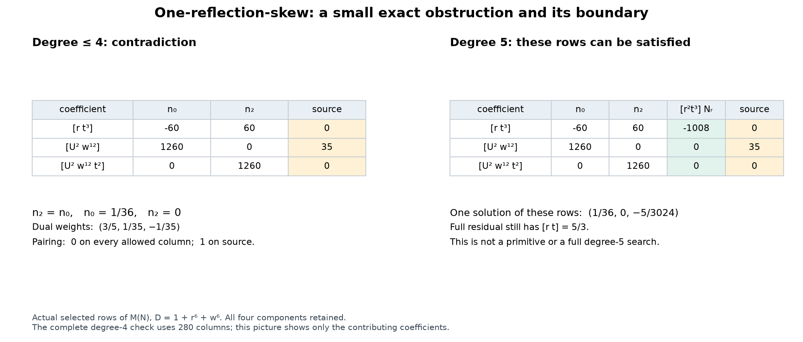

# A three-coefficient skew obstruction and its rank-two scope

21 October 2026. **The checkpoint-118 certificate is correct.** An independent
exact implementation checks all 280 columns for `D=a=1+r^6+w^6` and total
numerator degree at most four. The useful contribution is a short certificate
and a precise comparison with `fqlx`'s existing companion calculations.
**Additional exclusion coverage over that prior work has not been established.**

[](../visualizations/skew-small-obstruction.svg)

The figure displays actual selected coefficients of the operator, not a
geometric model. Its second panel shows why these three rows cease to give
a contradiction at degree five. It does not show a primitive or consistency
of the full degree-five system.

## Sources, attribution, and reused checks

Notebook base: [`e057d7e`](https://github.com/rbajaj5/hodge-lab/commit/e057d7e98ce6ab58a05dc80d76879eaf772f381c).
Upstream: [`a6b4cc4`](https://github.com/hodge-computer/sextics/commit/a6b4cc49452abe31ead0be71d04e8146639896d9).
Read current policies, checkpoint 118, and all six comments visible in
[live discussion 127](https://github.com/hodge-computer/sextics/discussions/127).
The public HTML contained no comment pagination or load-more control.
Rendered bodies and GitHub body-version hashes were retained; this access
did not provide raw Markdown or edit timestamps. It is not a complete
GraphQL monitoring-baseline replacement.

The quotient, residue, rank-two basis, connection, and companion formulation
are prior work of `fqlx` (Ben Burns), particularly
[comment 19080252](https://github.com/hodge-computer/sextics/discussions/127#discussioncomment-19080252).
Its attached packet has SHA-256
`3901f358ec9f1f46b6f4900cba80aa82160dd50d28e86e766aae826e39a960be`,
matching Hodge Lab's earlier pin. Selected source files are preserved with
attribution under [inputs/fqlx](../results/skew-small-obstruction/inputs/fqlx).

The protected polynomial and source equation are reused from
[checkpoint 118](skew-base-derivatives.md). The source-to-residue,
physical-source-transport, and covariant-jet audits remain completed work;
none was rerun. This pass independently reconstructs the small operator
from its pinned formula, and separately checks five elementary reductions.
It does not rederive the full physical source or rerun historical rank screens.

## 1. The short exact certificate

Use coordinates `(U,r,w,t)` and

$$
P=aU^3+bU^2+cU+d,\quad
(a,b,c,d)=\left(1+r^6+w^6,rt(1+r^2w),\frac{rt(1-t^2)}7,1+t^6\right).
$$

For all four components of `V=N/a`, the full equation is

$$
5\nabla P\cdot V-6P\operatorname{div}V=\frac5{12}U^2.
$$

Put `P7=7P`. After clearing denominators with the same scaling as checkpoint
118, the operator and source are

$$
\mathcal M(N)=60a\nabla P7\cdot N-72P7a\operatorname{div}N
                 +72P7N\cdot\nabla a,
\qquad s=35U^2a^2.
$$

All derivatives, including the denominator derivative, are present. Every
component of `N` contains every monomial of total degree at most four, with
independent constant coefficients. Set `n0=[1]N_U` and `n2=[t^2]N_U`.
Coefficient support gives exactly

| Selected coefficient | Left side | Right side |
| --- | ---: | ---: |
| `[rt^3]` | `60(n2-n0)` | `0` |
| `[U^2 w^12]` | `1260 n0` | `35` |
| `[U^2 w^12 t^2]` | `1260 n2` | `0` |

The equations force `n2=n0`, `n0=1/36`, and `n2=0`. Equivalently,

$$
\lambda=\frac35[rt^3]+\frac1{35}[U^2w^{12}]
             -\frac1{35}[U^2w^{12}t^2]
$$

annihilates all 280 operator columns and satisfies `lambda(s)=1`.
This is an exact characteristic-zero obstruction, also valid over complex
constant coefficients. It is not a numerical-rank inference.

The new standard-library `Fraction` checker constructs the coefficient
transpose, retaining its complete finite support, and also applies the
forward operator to every monomial column. It imports neither the original
search matrix nor its elimination code.

## 2. Where this particular certificate stops

For arbitrary polynomial numerators, the first selected coefficient is

$$
[rt^3]\mathcal M(N)=60(n_2-n_0)-504\left(
[Urt^3]N_U+2[r^2t^3]N_r+[rwt^3]N_w+4[rt^4]N_t\right).
$$

All four additional numerator coefficients have total degree five. The
other two selected formulas above remain unchanged through degree five.
For example, `N_r=r^2 t^3` pairs to `-3024/5` with the displayed dual.

More concretely,

$$
N=\left(\frac1{36},-\frac5{3024}r^2t^3,0,0\right)
$$

satisfies all three selected equations. Its full residual, however, has
`[rt](M(N)-s)=5/3`. **It is not a primitive.** This checks the boundary of
the three-row argument; no full degree-five matrix search was performed.

There is also an important testing limit: deleting the denominator-derivative
term happens to leave these three degree-four rows unchanged. The miniature
certificate alone cannot test that implementation detail. Checkpoint 118's
separate denominator-derivative positive control is still needed. Removing
the first dual term is detected on constant `N_U`, with pairing 36.

## 3. Exact overlap with the existing rank-two searches

Section 7 of `fqlx`'s `rank2_primitive_notes.md` uses the same `Y0=1` chart,
the basis `omega0=dU/z^5`, `omega1=U omega0`, and the necessary equation

$$
\sum_{i=r,w,t}(\partial_i+M_i)f_i=g.
$$

Its six scalar coefficient functions were screened as polynomials of base
degree at most six, or as `H/a` with `deg H<=6`. Both saved receipts report
504 columns and augmented rank 505 modulo 1000003. We read those receipts
and the matrix-construction code; **those ranks remain author-reported in
this audit and were not recomputed**. The existing code already differentiates
the base and the denominator.

Let `nu=dr wedge dw wedge dt`. Our primitive has the form

$$
\Gamma=\frac{N_U}{az^5}\nu
-\sum_i\frac{N_i}{a}\omega_0\wedge\iota_{\partial_i}\nu.
$$

If `N_i=A_i+U B_i`, then directly `f_i=(A_i/a,B_i/a)^T`, with base degrees
at most four and three. These lie inside the already screened degree-six
`H/a` space. The vertical term contributes a fiber-exact derivative and
vanishes in the relative cohomological equation. This proves a concrete
overlap: 165 of the 210 horizontal coefficients are affine in `U`. The 70
vertical coefficients do not alter that necessary rank-two equation.

The remaining 45 horizontal monomials have `U`-degree two, three, or four.
Their comparison requires reduction, because it can change denominators.
Independently checked identities use

$$
d_U(Qz)=-\left(PQ'+\frac16P'Q\right)\omega_0,
\qquad z^6=-P.
$$

For example,

$$
\frac{U^2}{a}\omega_0
=-\frac{c}{3a^2}\omega_0-\frac{2b}{3a^2}\omega_1
+d_U\left(-\frac{2z}{a^2}\right).
$$

Here `a` does not divide the physical polynomial `c`; exact polynomial
division confirms it. Thus this natural representative is not of the
previous `H/a` form. The five checked reductions for `U^k`, `0<=k<=4`,
can introduce denominators through `a^4` after the original division by `a`.
This is a common-denominator bound for a specific small image, not an
instruction to search every numerator over `a^4`.

**This denominator growth does not prove increased exclusion coverage.**
Actual solutions may admit other representatives, or the additional
operator images may lie in the old image. We have not identified the two
bounded problems modulo all permitted changes of primitive.

The exact correction is relative: keep the subscript `U`. If
`C_i omega0=omega f_i+d_U h_i`, adding
`d(sum_i h_i i_{partial_i} nu)` to the original primitive cancels these
horizontal exact terms and changes its vertical coefficient to
`B/z^5+sum_i partial_i h_i`. Those base corrections must be retained in an
absolute reconstruction. This pass checks the relative identities and
records that algebraic correction rule; it does not construct a primitive.

## 4. Publication decision and smallest next comparison

The live discussion and the pinned companion packet do not contain this
three-coefficient certificate or this explicit comparison of bounds. A
single concise reply beneath `fqlx`'s companion comment is justified as a
short independent certificate and scope clarification. It is not an
independent replay of the prior degree-six screen, a claim to first use
base derivatives, or a claim of larger coverage. An independent read-only
review agrees with that assessment.

The smallest further comparison is now specific: form the **rank-two
covariant-divergence images of the 45 higher-`U` columns**, and test whether
they lie in the span of the prior 504 degree-six `H/a` operator columns,
using a common exact denominator clearing. The reductions themselves are
already supplied here. Exact containment witnesses would show that the
prior rank-two exclusion covers this whole unreduced family at the
necessary-equation level. Noncontainment alone would still not establish
additional source coverage. This comparison was not executed in this pass.

Before any upstream reply, push this corresponding ledger audit. Read back
the actual reply and record its permalink afterward. Until that outcome is
recorded, the draft is not a published contribution and the tally remains
28 discussion contributions, one closed maintenance PR, zero accepted
authored solves.

## Original ChatGPT publication attempt (historical)

The integration rejected the first note-blob write with HTTP 403,
`Resource not accessible by integration`, before any tree, commit, or branch
update. The remote head was read back unchanged. At that handoff, the audit and reply remained unpublished; the ledger-first
rule prevented posting the reply first.
The complete checked changes are supplied as a patch for the authorized
Codex workflow. No authentication loop or upstream write was attempted.

## Codex handoff and refreshed scope — 21 October 2026

The reviewed patch was recovered directly from the ChatGPT conversation
**Update ledger status**. Its full original bytes were not transferred:
the [transport manifest](../results/skew-small-obstruction/transport-manifest.json)
records a derivative omitting only the generated PNG/SVG assets, plus their
original hashes. All four transport chunks, the compressed stream and the
154,923-byte decompressed transport patch passed their supplied SHA-256 checks.
The exporting thread reports that all 22 retained patch sections are unchanged;
the complete original-patch hash is recorded as supplied, not independently
recomputed. The figures were regenerated locally from the retained script and
exact data, inspected for readable labels, and given their own hashes.

A fresh isolated local run under Python 3.11.9 / SymPy 1.14.0 passed the same
299 requirements and 280 columns, the same five universal reductions, and
the basis/coefficient/nondivisibility checks. Mathematical JSON content matches
the supplied receipts exactly after excluding only timing and Python-version
fields. These counts are repeated validation, not additional proof coverage.
All 15 supplied input/script pins match. Three processes took 5.375 seconds
for the whole validation batch; each had a 60-second limit and the batch had
a 180-second ceiling. No timeout. The original review receipts are preserved;
the [Codex replay](../results/skew-small-obstruction/codex-replay/validation.json)
records the separate commands, outputs, versions and rendering differences.

The [complete GraphQL refresh](../results/skew-small-obstruction/discussion-prepublication.json)
at 23:33:38 UTC includes six top-level comments and one reply, with all pages
fetched. Both repository heads remain the input pins above. The new
`fqlx` [reply 19108825](https://github.com/hodge-computer/sextics/discussions/127#discussioncomment-19108825)
reports a compact source/kernel construction and a polynomial-`w` compact-flux
exclusion. It does not duplicate this three-coefficient certificate. Its
checks are author-reported here: neither that packet nor a comparison with
its parameter space was replayed. No additional coverage relative to that
new result is claimed. The 45-column image comparison described above remains
unexecuted in this audit, not a claim that other contributors have done no
related work.

Two read-only Codex reviews inspected the mathematical scope and refreshed
discussion; they add no executed-check count. A separate publication-script
review checked the ledger-first and location/readback guards. The refreshed
draft is prepared for one reply beneath `fqlx` comment 19080252, after this
audit is pushed. Current publication status is recorded in
[publication.json](../results/skew-small-obstruction/publication.json).

## Reproduction and verification limits

```sh
python -O scripts/check_skew_small_obstruction.py
python -O scripts/reduce_skew_small_obstruction.py
python scripts/visualize_skew_small_obstruction.py
```

The first checker needs only Python's standard library. The reduction needs
SymPy; the plot needs Matplotlib. Pinned `fqlx` input JSON is included, so no
network request is needed to replay these checks.

The initial independent execution passed 299 explicit requirements including
280 complete columns, in 0.015 seconds internally. The independent reduction
checked five polynomial identities, the source basis/four coefficient
bindings, and nondivisibility, in 0.123 seconds internally. A prior 297-check
development run is nested, not additional proof coverage. Reproduction from
the final repository paths is recorded separately in
[validation.json](../results/skew-small-obstruction/validation.json).
Every computation has a 60-second process limit; the batch ceiling is
180 seconds. The public-page and attachment requests each had a 30-second
network timeout. No historical large-packet search was executed.

[Inputs and hashes](../results/skew-small-obstruction/inputs.json) ·
[Exact coefficient replay](../results/skew-small-obstruction/three-coefficient-replay.json) ·
[Five relative reductions](../results/skew-small-obstruction/horizontal-reduction.json) ·
[Review scope](../results/skew-small-obstruction/review.json) ·
[Publication record](../results/skew-small-obstruction/publication.json).

No arbitrary rational primitive exclusion, homogeneous certificate-degree
bound, new `HasCertificate` theorem, Lean/kernel verification, trace,
ambient lift, or global clearing follows. Credit Benjamin E. Diamond and
contributors for the protected framework; `fqlx` for the quotient, source,
connection, and companion work; and checkpoint 118 for the original small
dual. Prepared for `rbajaj5` with ChatGPT and parallel AI-agent assistance.
Independent checks here mean separate implementations, not human review.

## Verified publication — 21 October 2026

The audit was pushed first as
[`c3ab521`](https://github.com/rbajaj5/hodge-lab/commit/c3ab5214fcff79309ad1e7ae83b9e436afeb1d39).
The [checked reply](https://github.com/hodge-computer/sextics/discussions/127#discussioncomment-19111234)
is published beneath `fqlx` comment 19080252. A separate API read verified
its exact body, `rbajaj5` authorship, parent, discussion and permalink. The
body is the committed draft with its audit link pinned to that commit.
See the [verified outcome](../results/skew-small-obstruction/upstream-publication/publication-outcome.json).

This adds one discussion contribution, bringing the tally to **29 discussion
contributions, one closed maintenance PR, zero accepted authored solves**.
It changes no mathematical scope or acceptance status. The earlier integration
failure above remains historical evidence; it is no longer the current
publication status.
