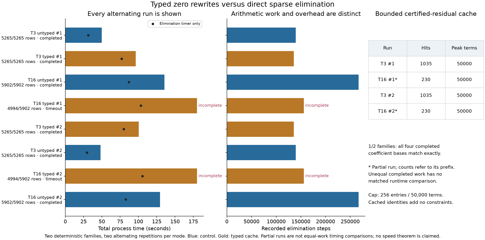
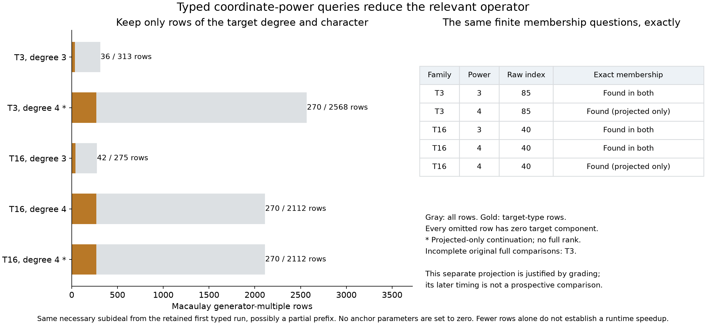
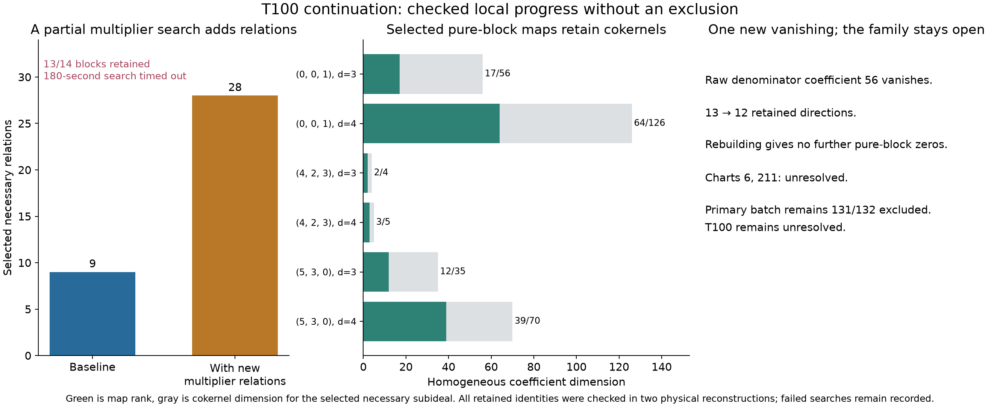
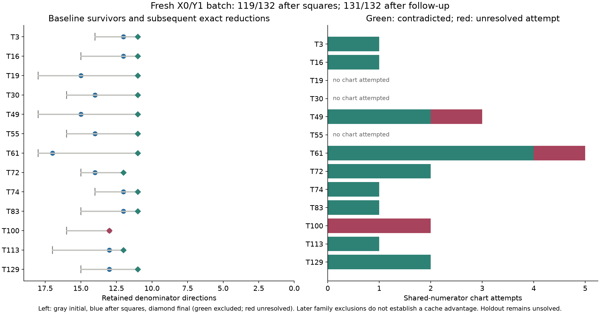

# Typed rewrites on fresh three-character families

This experiment tests the user's proposal to use typed rewriting while
continuing the fixed holdout search. The source of the idea is Vishnikin
and Okhotin's [*Categorial grammars with unique category assignment*](https://arxiv.org/abs/2505.14559),
especially their primitive-category count invariant. The precise theorem
is an expressiveness result under homomorphic encoding. It does not
provide a polynomial-ideal solver or a computational speedup theorem.

The initial exact square pass excludes **119 of 132 fresh families**,
leaving thirteen for continuation. The initial checkpoint is preserved
independently of the later comparison and any further search.

The ordinary block/chart/rebuilding continuation closes twelve more,
giving a preserved **131/132 checkpoint**, or **811 selected triples**
including the preceding 680. T100 remains unresolved at that checkpoint.
This progress uses the existing exact method and is not attributed to a
speedup from typed caching.


The displayed T3 operator has 5,265 rows, 4,166 columns, 113,854 nonzero
coefficients, and 24 degree/character types. Both physical constructions
produce the same matrix. The right panel is an invertible row/column
permutation, not an additional reduction or a different timed algorithm.

## What is implemented

Our types are total coefficient degree together with a diagonal character
in `(Z/6Z)^3`. They belong to the actual polynomial system's grading.
If `a_i` is a denominator coefficient, give it auxiliary weight `chi(D_i)`.
If `z_k` is a numerator-correction coefficient, give it weight
`chi(K_k)-chi(A)`. The latter character is derived from the vector-field
components, rather than guessed from a label. This is a defined grading
of the parameter ring; it is not a claim about the contragredient action
on geometric parameter coordinates.

The fixed physical equations are quadratic. A coefficient equation for
a physical monomial of character `eta` has parameter weight
`eta-chi(A)`: both `a_i*a_j` and `a_i*z_k` terms match that weight.
Every equation is checked for a single degree and character. Multiplying
by a denominator monomial adds its degree and character. Row reduction
must preserve the resulting type.

The experimental cache stores certified reductions of an exact normalized
residual to zero. Each rule includes an expression in the original
equations times allowed monomials. It can only be reused for that same
residual with the same type. These identities stay valid as the pivot
basis grows. A cached full normal form would need extra care when the
basis changes; we avoid relying on stale normal forms.

The control is the existing sparse rational elimination with direct
leading-pivot lookup. It already respects types implicitly: two rows
can cancel at a pivot only if they share a nonzero column. The experiment
therefore asks whether explicit typing and certified rewrite caching
save computation. It does not add mathematical constraints or license
cancellation merely because two types agree.

## Comparison and evidence standards

The batch consists of 132 fresh X0/Y1 extensions outside the preceding
680-family selection. The anchor characters are `(0,0,1)` and `(5,3,0)`.
Local **T IDs** distinguish this selection from preceding A/B/Y/H batches.
Each family uses its complete retained character
eigenspaces modulo the established six-direction `F*S1` gauge. The
holdout target `(F,q,A)` stays fixed at upstream revision
`b8c4edeb80a82395ec07164caf445cfa43bbbd56`, with q=1. A nonzero quotient
and all stabilizer-allowed numerator corrections are permitted.

The comparison selection is frozen from the square-pass survivors before
either search mode runs. Both modes receive the same unnormalized
physical equations, row order, and constant/linear denominator
multipliers, with matching limits. Sequential repetitions alternate
mode order. Exact checks compare completed coefficient bases, not just
their dimensions, and replay the exported relation witnesses against
the physical equations. Runtime includes implementation overhead and
is recorded as an exploratory comparison on this host, not a universal
performance claim. Incomplete runs cannot establish equal full spans.

This compares a whole prototype with the existing implementation: typing
and caching change together, and the prototype copies intermediate
dictionaries where the control updates them in place. Normalization and
proof bookkeeping also cost time. There is no cache-only or allocation-only
ablation, so a timing difference cannot be attributed to typing alone.
The frozen runs are retained without tuning these choices after seeing
their performance.

These searches and exact checks use CPU rational arithmetic; no GPU is
required by this implementation. Yang's geometric interpretation remains
motivation, as explained in the [reference note](categorical-syzygies.md),
not a theorem whose hypotheses have been established for these parameter
ideals. Accelerating matrix computations would not establish that missing
geometric identification.

After the comparison, further block powers, shared-numerator charts, and
rebuilding may continue the family search. Those later exclusions do not
establish an advantage for the typed cache. The original comparison,
bounded failures, and any later progress remain separate in the record.

The square-pass survivors are T3, T16, T19, T30, T49, T55, T61, T72,
T74, T83, T100, T113, and T129. The comparison takes the first two by
ascending T ID. This is a small deterministic sample, not a randomized
benchmark over the remaining search space.

The known full X0/Y1 pair dependency is reconstructed from all thirteen
retained directions. Squares reduce it to eleven; charts for raw
coefficients 56 and 102 contradict while nine others remain unsuccessful.
Rebuilding leaves the previously checked pure-Y1 support
`135,235,272,289,293`. This is a reproduced dependency, not a new pair result.

The thirteen ordinary continuations each have a 120-second process bound,
with two workers. Both physical reconstructions pass. They check 4,246
physical duals, 347,162 correction pairings, 91,172 quadratic pairings,
480 square identities, 81 graded maps, ten higher-power identities, and
nineteen charts with 550 exact inferences. Fifteen charts contradict;
four fail under the propagation used. In T49, raw coefficient 223's chart
fails before rebuilding closes the family. In T61, raw 213's chart first
fails and later contradicts after rebuilding. Both T100 charts, for raw
6 and 211, remain unsuccessful. These four failures are retained, including
those later resolved. The full anchor dependency's eleven charts and
34 duals are counted separately.

### Frozen cache comparison: no speed advantage



Each subprocess had a 180-second bound and a 10,000-row ceiling. The full
requested maps fit under the ceiling: 5,265 rows for T3 and 5,902 for T16.
The cache was bounded at 256 entries and 50,000 coefficient terms, with
at most eight snapshots per dependent row and 1,000 terms per rule.
Rows, pivot ordering, and budgets were fixed before the runs.

| Family / mode | Replicate 0 wall seconds | Replicate 1 wall seconds | Retained rows / requested | Rank | Additional necessary relations |
| --- | ---: | ---: | ---: | ---: | ---: |
| T3 reference | 49.94 | 48.17 | 5,265 / 5,265 | 2,795 | 97 |
| T3 typed cache | 96.20 | 100.34 | 5,265 / 5,265 | 2,795 | 97 |
| T16 reference | 135.46 | 129.51 | 5,902 / 5,902 | 4,471 | 90 |
| T16 typed cache | timeout at 180.05 | timeout at 180.04 | 4,994 / 5,902 | 3,949 | 59 |

The additional counts are independent modulo the finite span of affine
multiples of the constant-multiplier baseline. They are not generators
certified for the full elimination ideal. T3's four completed runs have
the same coefficient basis. The typed implementation records 1,035 cache
hits and 135,727 elimination steps versus 139,614 reference steps: 2.78%
fewer steps, but slower execution. Elimination-only times were
76.93/79.98 seconds versus 31.28/29.53 seconds. This whole prototype did
not improve runtime; the allocation and bookkeeping confounds above
prevent attributing the slowdown to typing alone.

Both interrupted T16 runs retain the same last fully written multiplier
block. They record 230 cache hits at that checkpoint. Time spent on the
interrupted block is included in process wall time but not in the durable
checkpoint's elimination time. No equal-work speed ratio or full-span
equality is claimed for T16's interrupted runs. Cache application counts
are execution telemetry; the exact checker establishes the rule identities
and processed-prefix rowspaces, not a proof of every runtime event.

The discovery code and frozen packets were not tuned after these results.
Checker-only metadata validation was tightened afterward. The retained
comparison is a negative performance result, including both timeouts.

Both physical reconstructions pass the eight retained packets. The checker
verifies both containments of each processed-prefix rowspace and each used
zero-rule identity. It can reuse a replay only after comparing the entire
canonical proof payload, including source witnesses, not merely a rank or
coefficient-basis hash. Three distinct payloads are replayed and five
identical payloads reuse those checks; every run's metadata, rules, and
applications are still checked individually. A small additional cache test
checks that a zero rewrite survives basis growth, adjusts a new witness
context correctly, and rejects a witness that uses a future input row.

## A separate goal-directed type filter

The cache comparison retains every input row. A second experiment asks
whether types can avoid irrelevant rows for a *specified* algebraic query.
It uses the same two selected families and tests added-character coordinate
powers in degrees three and four, using the verified necessary relations
from the last completed checkpoint of typed replicate zero. If that
process times out later, the source row count and incomplete status stay
visible; a verified subset still gives necessary equations, but is not
called the output of a completed full multiplier search.

For each degree, construct the full mixed-degree Macaulay map: a generator
of degree e is multiplied by every denominator monomial of degree d-e.
To test `a_i^d`, retain exactly the rows of type `(d,d*chi_i)`. Every
discarded row has zero projection to that type, and every retained row
lies entirely in it. Thus projection of a full witness supplies a witness
in the retained block; conversely every retained row belongs to the full
map. This proves equivalence of the specified membership question, not
equality of the full ranks.

Both maps are computed and their coordinate-power answers compared
exactly. Any successful identities must still expand to the required
power and then bind to the original physical equations. Failure in these
finite spans does not rule out identities at higher degrees. This is a
different mechanism from memoized rewriting and gets a separate record;
it also avoids claiming extra character pruning within a pure-character
block whose fixed-degree rows already all share one type.

The cubic queries complete in both full and projected maps:

| Family / degree | Full rows | Target-type rows | Full rank | Target-type rank | Exact power |
| --- | ---: | ---: | ---: | ---: | --- |
| T3 / 3, matched maps | 313 | 36 | 287 | 22 | `a85^3` |
| T16 / 3, matched maps | 275 | 42 | 246 | 22 | `a40^3` |
| T3 / 4, projected-only follow-up | 2,568 | 270 | not computed | 148 | `a85^4` |
| T16 / 4, matched maps and separate projected follow-up | 2,112 | 270 | 1,283 | 148 | `a40^4` |

After the full T3 quartic reduction timed out, a separate 60-second-per-case
follow-up reduced only the target-type block for each of the same two
families. It still constructed every full row and checked its literal
projection. Both projected quartic jobs completed, at 15.56 and 13.78
seconds on this host. These follow-ups ran alongside other work and were
selected after a timeout; no isolated speed ratio or prospective runtime
comparison is claimed. The separate original T16 full comparison later
completed at 171.69 seconds within its 180-second bound, including its
full quartic rank of 1,283. T3's original comparison timed out, retaining
only the cubic result. The projected-only follow-up did not itself compute
either full quartic rank. Equality
of the specified membership question follows from the checked grading
and direct-sum projection argument, not from a completed full elimination.

The quartic powers give no new coordinate vanishings beyond the cubic
powers. These examples already close through the ordinary continuation,
so they are not counted again. T16's necessary generators come from the
verified 4,994-row prefix of its timed-out typed search; this source is a
necessary subset, not the full multiplier output. Both physical polynomial
implementations reproduce the projected quartic maps and identities,
including 4,680 literal row projections, 32,561 source-relation products,
and rejection of both deliberately altered power witnesses.



## T100: an unsuccessful continuation with one new vanishing

The separate [T100 packet](../results/typed-rewrite-families/t100/)
reconstructs its actual X0/Y1/added-character shared-numerator equations.
The constant/linear multiplier job times out at 180 seconds with thirteen
of fourteen multiplier blocks retained. It yields nineteen additional
necessary relations modulo the finite baseline-plus-linear span. Both
physical checks replay the retained identities, including 16,048 source
products; the missing multiplier block is not counted as processed.

Pure-character degree-three/four maps force raw coefficient 56 to vanish,
reducing thirteen denominator directions to twelve. The rebuilt system
still does not contradict either chart for raw 6 or 211. The remaining
support is `6,42,88,102,111,114,135,211,235,272,289,293`.
The block and closure jobs each have a 180-second bound and complete.
All six supplemental verification variants pass, but **T100 is not
excluded**. The final batch count stays 131/132 and the selected union 811.
This is a further failed solve attempt, with a useful exact reduction.





## Scope of the grammar connection

The paper's additive primitive counts take values in a free abelian group;
our characters take values in a finite abelian group. Both can serve as
conserved signatures. This analogy motivates the experiment; the direct
sum of polynomial weight spaces justifies our algebraic decomposition.
We do not construct the paper's category-encoding gadgets, identify its
syntactic numerator/denominator with our rational-function numerator and
denominator, or reduce Hodge certificate search to a grammar problem.
In particular, the paper's encoding can neutralize primitive counts to
simulate choice; our type filter retains discriminating weights. These
are different uses of additive invariants.

Unique lexical typing does not imply unique parsing. Likewise, matching
degree and character leaves many possible algebraic derivations, and
matching types alone proves no identity. No geometric Koszul cohomology
identification, full resolution, Yang theorem, Eisenbud-Erman categorical
pairing, or phase transition is asserted by this experiment.

## Reproduce the retained evidence

From this checkout with its pinned `sources/sextics` submodule, the exact
checks use Python 3.11's standard library:

```sh
python -S experiments/check_typed_rewrite_families.py --follow
python -S experiments/check_typed_rewrite_families.py --follow --independent
python -S experiments/typed100_continuation.py --check
python -S experiments/typed100_continuation.py --check --independent
python -S experiments/typed100_continuation.py --check-blocks
python -S experiments/typed100_continuation.py --check-blocks --independent
python -S experiments/typed100_continuation.py --check-closure
python -S experiments/typed100_continuation.py --check-closure --independent
python -S experiments/typed_rewrite_search.py --check
python -S experiments/typed_rewrite_search.py --check --independent
python -S experiments/typed_goal_powers.py --check
python -S experiments/typed_goal_powers.py --check --independent
python -S experiments/typed_goal_quartics.py --check
python -S experiments/typed_goal_quartics.py --check --independent
python -S experiments/plot_typed_rewrite.py --check
```

The independent variant reconstructs physical polynomials through a
separate API and division order. It shares the small identity-replay
utilities. A second AI source review is also distinct from independent
human review or Lean acceptance. The figure check reconstructs the actual
operator, checks the type permutation, and binds the displayed outcomes
to the retained proof packets. Rendering the PNG/SVG figures additionally
uses Matplotlib.

All fifteen commands above passed locally. All five rendered figures were
visually inspected. Remote CI is not claimed before its dedicated job
finishes. Holdout remains unsolved; these results neither improve the
unconditional degree bound nor constitute a Lean certificate or solve PR.

Prepared with OpenAI Codex assistance for rbajaj5. Credit the project
authors' certificate/geometric-support framework, the bridge attributed
there to Benjamin E. Diamond, Griffiths's residue theory, fqlx's E1/Koszul
and symmetry work, the prior exact exclusion and rebuilding calculations,
and Eisenbud's graded-module viewpoint. The grammar authors motivate the
signature idea; their encoding theorem is not the proof of any exclusion.
